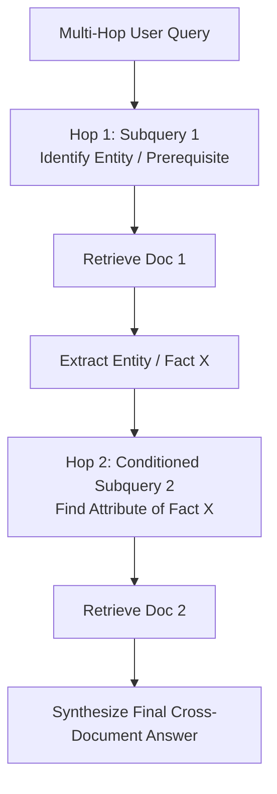

# Notes: Multi-Hop RAG & Query Decomposition

## 1. The Multi-Hop Retrieval Challenge
Single-shot vector retrieval fails on multi-hop reasoning questions where the final answer requires combining facts from two or more unconnected documents:
- Query: *"Who is the CEO of the company that created the transformer model?"*
- Document A: States Google created transformers (mentions Google, transformers, no CEO).
- Document B: States Sundar Pichai is CEO of Google (mentions Sundar Pichai, CEO, Google, no transformers).
A single vector query cannot bridge the semantic gap because neither document independently contains both the question subject and the final answer.

## 2. Sequential Decomposition Pipeline

- **Provenance Chaining**: The final answer links back to the entire DAG chain of source documents $[Doc_1 \to Doc_2]$.
