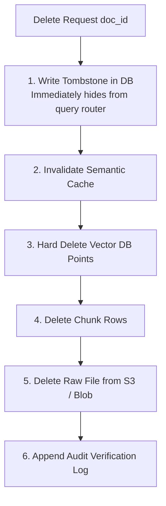

# Notes: Document Deletion & Vector Consistency

## 1. The "Ghost Vector" Problem
When a user deletes a confidential document (or GDPR right-to-be-forgotten request arrives), simply removing the document row from PostgreSQL creates a critical vulnerability:
- **Vector Index Desynchronization**: Vector databases (like Qdrant, Milvus, Chroma) store isolated vector points with detached payloads. If not explicitly deleted, the vector points continue being retrieved as top-K nearest neighbors.
- **Cache Poisoning**: The application semantic cache continues serving the deleted content for matching past queries.
- **LLM Data Leak**: The LLM summarizes chunks from a deleted document, violating compliance and privacy laws.

## 2. Distributed Saga / Two-Phase Cascade

