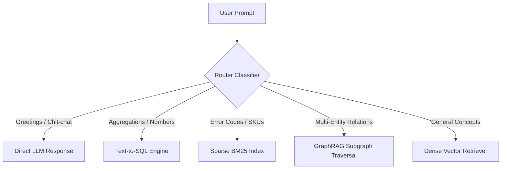

# Notes: Dynamic Query Routing Architecture

## 1. Why a Single Pipeline Fails All Queries
A naive RAG pipeline routes every prompt through the same vector index:
- Greetings ("Hi", "Thanks") waste vector search latency and inject irrelevant chunks into conversational prompts.
- Aggregations ("What is the average price of item X?") fail on vector search because vector databases cannot perform SUM/AVG math over 50,000 rows.
- Code identifiers ("Error 0x80070005") fail under dense cosine similarity due to token fragmentation.

## 2. Dynamic Dispatch Taxonomy

Routing reduces average end-to-end latency by skipping retrieval for 20–30% of user turns and routing quantitative queries to relational analytics.
