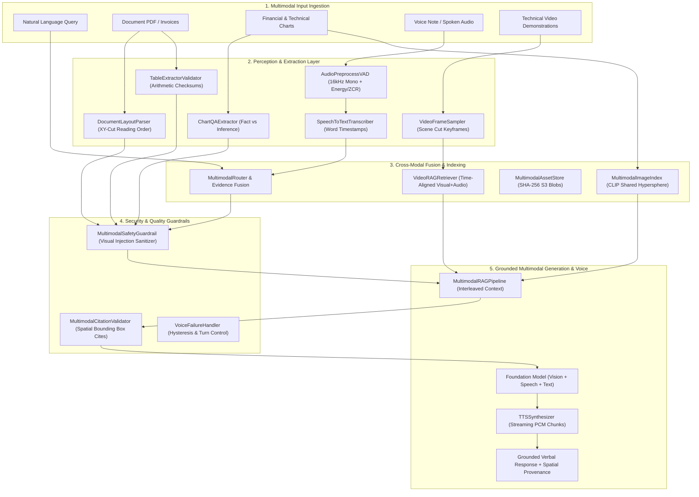

# 📅 Month 06 — Multimodal GenAI, Document AI & Voice

> **Focus:** Multimodal Ingestion Architectures, Vision-Language Model (VLM) APIs, Dynamic Image Tiling & Token Costing, OCR vs. VLM Benchmarking (CER/WER), Document Layout Understanding & Reading Order Topological Sorting, Table Extraction & Arithmetic Cross-Validation, Chart QA & Visual Data Grounding, Multimodal Image Embeddings & Vector Search (CLIP), Multimodal RAG with Bounding-Box Citations, Audio Preprocessing & Voice Activity Detection (VAD), Speech-to-Text Transcription with Word-Level Timestamps, Text-to-Speech Streaming Synthesizer, Real-Time Audio Streaming Sessions, Turn-Taking Controllers, Speech-to-Speech Architectures, Voice Agent Tools, Multilingual Speech, Video Frame Sampling, Video RAG, Multimodal Asset Stores, Visual Prompt Injections, Cross-Modal Retrieval Metrics, Citation Validation, Cost/Latency Pareto Analysis, Workflow Orchestration, FastAPI Gateways, Voice UX Fallback Handlers, and Project 6 Capstone Release.
>
> **Major Project:** Project 6: Multimodal Knowledge Assistant — Document, Image, and Audio Ingestion with Searchable Visual Evidence and a Voice Interface.

---

## 🏗️ Architecture: Multimodal Knowledge Assistant Pipeline

---

## 🎯 Day-by-Day Implementation Plan (Day 01 – Day 30)

| Day | GenAI / Multimodal Topic | Key Deliverables (Python in `AI/`) | DSA Revision (Java in `DSA/`) | Status |
|:---:|:-------------------------|:-----------------------------------|:------------------------------|:------:|
| [Day 01](Day-01/) | **Multimodal Architecture Overview** | `multimodal_architecture_router.py` (Modality token budgeting, early/late fusion) | QuickSort Partitions & Duplicate Handling (`QuickSortPartitions.java`) | ✅ Done |
| [Day 02](Day-02/) | **Vision-Language Model APIs** | `image_qa_vision_service.py` (Tile cropping, detail token costing, visual JSON) | Stable MergeSort & Inversion Counter (`MergeSortStable.java`) | ✅ Done |
| [Day 03](Day-03/) | **OCR Fundamentals vs VLM** | `ocr_engine_comparator.py` (CER/WER metrics, degraded scan simulation) | In-Place HeapSort $O(1)$ Space (`HeapSortInPlace.java`) | ✅ Done |
| [Day 04](Day-04/) | **Document Layout Understanding** | `layout_parser.py` (Header/footer filter, XY-cut reading order) | Stable Counting Sort & Radix Sort (`CountingSortRadixSort.java`) | ✅ Done |
| [Day 05](Day-05/) | **Table Extraction & Reasoning** | `table_extractor_validator.py` (Row/col arithmetic sums, hallucination audit) | Binary Search Patterns LC 33, 34, 162 (`BinarySearchPatternsRevision.java`) | ✅ Done |
| [Day 06](Day-06/) | **Charts & Visual Data Extraction** | `chart_qa_extractor.py` (Axis parsing, observed facts vs speculative inferences) | Two Pointers: 3Sum, Container, Rain Water LC 15, 11, 42 (`TwoPointersRevision.java`) | ✅ Done |
| [Day 07](Day-07/) | **Multimodal Image Embeddings** | `multimodal_image_index.py` (CLIP dual-encoder, cosine similarity search) | Sliding Window: LC 3, 76, 1004 (`SlidingWindowRevision.java`) | ✅ Done |
| [Day 08](Day-08/) | **Multimodal RAG Pipeline** | `multimodal_rag_pipeline.py` (Fused text/image/table retrieval & provenance) | Prefix/Suffix: Product Except Self, Subarray Sum LC 238, 560, 523 (`PrefixSuffixPatterns.java`) | ✅ Done |
| [Day 09](Day-09/) | **Audio Pipeline Foundations** | `audio_preprocess_vad.py` (Resampling to 16kHz, energy/ZCR Voice Activity Detection) | Fast & Slow Pointers: Cycles & Happy Number LC 141, 142, 202 (`FastSlowPointersRevision.java`) | ✅ Done |
| [Day 10](Day-10/) | **Speech-to-Text Integration** | `speech_to_text_transcriber.py` (Word-level timestamps, SRT export, silence filters) | Advanced Linked Lists: k-Group Reversal & Reorder LC 25, 143 (`LinkedListAdvancedRevision.java`) | ✅ Done |
| [Day 11](Day-11/) | **Transcription Evaluation** | `transcription_metrics.py` (WER, CER, WIL, domain-specific terminology accuracy) | Monotonic Stack: Largest Rectangle & Temperatures LC 84, 739 (`MonotonicHistogram.java`) | ✅ Done |
| [Day 12](Day-12/) | **Text-to-Speech Integration** | `tts_synthesizer.py` (Streaming PCM chunks, sentence boundary buffering) | Binary Tree Traversals: Iterative Pre/In/Post/Level (`BinaryTreeTraversals.java`) | ✅ Done |
| [Day 13](Day-13/) | **Real-Time Audio Streaming** | `audio_streaming_session.py` (WebSocket sessions, partials, barge-in cancellation) | BST Patterns: Validate, Kth Smallest, Delete Node LC 98, 230, 450 (`BSTValidationAndDeletion.java`) | ✅ Done |
| [Day 14](Day-14/) | **VAD and Turn-Taking** | `voice_turn_taking.py` (Speech onset sustain, pause endpointing, turn control) | Tree Construction: Pre+Inorder LC 105 & Post+Inorder LC 106 (`ConstructTreeTraversals.java`) | ✅ Done |
| [Day 15](Day-15/) | **Speech-to-Speech Architecture** | `speech_to_speech_pipeline.py` (Cascaded ASR->LLM->TTS vs Native audio comparison) | Heap Patterns: Kth Largest, Top K, Merge K Sorted Lists LC 215, 347, 23 (`HeapPatternsRevision.java`) | ✅ Done |
| [Day 16](Day-16/) | **Voice Agent Tool Integration** | `voice_agent_tools.py` (Spoken intent mapping, confirmation dialogs) | Graph Traversal: Number of Islands LC 200 & Components LC 323 (`GraphTraversalRevision.java`) | ✅ Done |
| [Day 17](Day-17/) | **Multilingual Voice Systems** | `multilingual_voice_service.py` (Language identification, code-switching normalization) | Shortest Paths: Dijkstra Network Delay Time LC 743 (`DijkstraAndCheapestFlights.java`) | ✅ Done |
| [Day 18](Day-18/) | **Video Understanding Fundamentals**| `video_frame_sampler.py` (Scene-change detection, timestamp alignment, clip summaries)| Topological Sort: Course Schedule II LC 210 (`TopologicalSortRevision.java`) | ✅ Done |
| [Day 19](Day-19/) | **Video RAG** | `video_rag_retriever.py` (Synchronized keyframe + transcript retrieval, time anchors) | Graph Connectivity: Redundant Connection DSU LC 684 & Bipartite LC 785 (`GraphConnectivityDSU.java`) | ✅ Done |
| [Day 20](Day-20/) | **Multimodal Data Storage** | `multimodal_asset_store.py` (SHA-256 content deduplication, blob vault, metadata) | Backtracking: Subsets LC 78 & Combination Sum LC 39 (`BacktrackingCombinations.java`) | ✅ Done |
| [Day 21](Day-21/) | **Multimodal Safety** | `multimodal_safety_guardrails.py` (Visual prompt injection, hidden OCR instruction sanitize) | 1D Dynamic Programming: Climbing Stairs LC 70, House Robber LC 198, Coin Change LC 322 (`DynamicProgramming1DRevision.java`) | ✅ Done |
| [Day 22](Day-22/) | **Cross-Modal Retrieval Evaluation**| `cross_modal_evaluator.py` (Recall@K, MRR, NDCG@K for text-image-audio search) | 2D Dynamic Programming: Unique Paths LC 62 & LCS LC 1143 (`DynamicProgramming2DRevision.java`) | ✅ Done |
| [Day 23](Day-23/) | **Multimodal Answer Grounding** | `multimodal_citation_validator.py` (Spatial bounding-box & timestamp citation audit) | Knapsack DP: Partition Equal Subset Sum LC 416 (`KnapsackRevision.java`) | ✅ Done |
| [Day 24](Day-24/) | **Multimodal Cost and Latency** | `multimodal_cost_latency_profiler.py` (Modality token pricing, latency breakdown) | String Dynamic Programming: Edit Distance LC 72 (`StringDPRevision.java`) | ✅ Done |
| [Day 25](Day-25/) | **Multimodal Workflow Orchestration**| `multimodal_workflow_orchestrator.py` (Async DAG task queues, progress events, retries)| Trie Applications: Implement Trie LC 208 (`TrieApplicationsRevision.java`) | ✅ Done |
| [Day 26](Day-26/) | **Multimodal User Experience API** | `multimodal_api_service.py` (FastAPI multipart upload, SSE token streaming) | Bit Manipulation: Single Number LC 136 & Counting Bits LC 338 (`BitManipulationRevision.java`) | ✅ Done |
| [Day 27](Day-27/) | **Voice UX and Failure Handling** | `voice_failure_handler.py` (Silence timeouts, noise overload, reprompt fallbacks) | Intervals & Sweep Line: Merge Intervals LC 56 & Meeting Rooms II LC 253 (`IntervalsSweepLineRevision.java`) | ✅ Done |
| [Day 28](Day-28/) | **Multimodal Benchmark Design** | `multimodal_benchmark_runner.py` (Golden test suites, extraction/grounding benchmarks) | Cache Design Mastery: LRU Cache O(1) LC 146 (`CacheDesignMastery.java`) | ✅ Done |
| [Day 29](Day-29/) | **Project Integration and Hardening**| `multimodal_assistant_hardened.py` (Full pipeline audit, telemetry spans, defense) | FAANG Comprehensive Timed Mock: Trapping Rain Water LC 42 (`ComprehensiveMockInterview.java`) | ✅ Done |
| [Day 30](Day-30/) | **Project 6 Release** | `project6_multimodal_assistant_release.py` (Production manifest, end-to-end release) | DSA Weak-Area Repair: Binary Tree Maximum Path Sum LC 124 (`DSAWeakAreaRepair.java`) | ✅ Done |

---

## 🏗️ Directory Architecture

Every day module strictly adheres to the established repository standard:
- `AI/` — **Python GenAI engines, multimodal perception, audio/voice pipelines, and safety auditors.**
- `DSA/` — **Runnable Java solutions with comprehensive `main` verification test drivers.**
- `Interview/` — **Technical Q&A deep-dives covering systems design, architectures, and algorithm invariants.**
- `Notes/` — **Explanatory engineering notes detailing theory, architecture, and production trade-offs.**
- `README.md` — **Individual day guide with problem breakdown, folder layout, and run instructions.**
