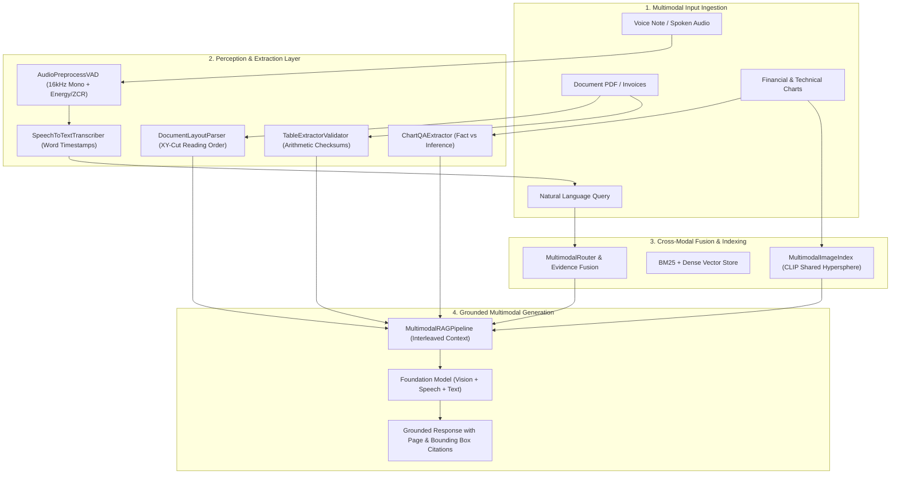

# 📅 Month 06 — Multimodal GenAI, Document AI & Voice

> **Focus:** Multimodal Ingestion Architectures, Vision-Language Model (VLM) APIs, Dynamic Image Tiling & Token Costing, OCR vs. VLM Benchmarking (CER/WER), Document Layout Understanding & Reading Order Topological Sorting, Table Extraction & Arithmetic Cross-Validation, Chart QA & Visual Data Grounding, Multimodal Image Embeddings & Vector Search (CLIP), Multimodal RAG with Bounding-Box Citations, Audio Preprocessing & Voice Activity Detection (VAD), and Speech-to-Text Transcription with Word-Level Timestamps.
>
> **Major Project:** Project 6: Multimodal Knowledge Assistant — Document, Image, and Audio Ingestion with Searchable Visual Evidence and a Voice Interface.

---

## 🏗️ Architecture: Multimodal Knowledge Assistant Pipeline



---

## 🎯 Day-by-Day Implementation Plan (Day 01 – Day 10)

| Day | GenAI / Multimodal Topic | Key Deliverables (Python in `AI/`) | DSA Revision (Java in `DSA/`) | Status |
|:---:|:-------------------------|:-----------------------------------|:------------------------------|:------:|
| [Day 01](Day-01/) | **Multimodal Architecture Overview** | `multimodal_architecture_router.py` (Modality token budgeting, early/late fusion) | QuickSort Partitions & Duplicate Handling (`QuickSortPartitions.java`) | ✅ Done |
| [Day 02](Day-02/) | **Vision-Language Model APIs** | `image_qa_vision_service.py` (Tile cropping, detail token costing, visual JSON) | Stable MergeSort & Inversion Counter (`MergeSortStable.java`) | ✅ Done |
| [Day 03](Day-03/) | **OCR Fundamentals vs VLM** | `ocr_engine_comparator.py` (CER/WER metrics, degraded scan simulation) | In-Place HeapSort $O(1)$ Space (`HeapSortInPlace.java`) | ✅ Done |
| [Day 04](Day-04/) | **Document Layout Understanding** | `layout_parser.py` (Header/footer filter, XY-cut reading order) | Stable Counting Sort & Radix Sort (`CountingSortRadixSort.java`) | ✅ Done |
| [Day 05](Day-05/) | **Table Extraction & Reasoning** | `table_extractor_validator.py` (Row/col arithmetic sums, hallucination audit) | Binary Search Patterns LC 33, 34, 162 (`BinarySearchPatternsRevision.java`) | ✅ Done |
| [Day 06](Day-06/) | **Charts & Visual Data Extraction** | `chart_qa_extractor.py` (Axis parsing, observed facts vs speculative inferences) | Two Pointers: 3Sum, Container, Rain Water LC 15, 11, 42 (`TwoPointersRevision.java`) | ✅ Done |
| [Day 07](Day-07/) | **Multimodal Image Embeddings** | `multimodal_image_index.py` (CLIP dual-encoder, cosine similarity search) | Sliding Window: LC 3, 76, 1004 (`SlidingWindowRevision.java`) | ✅ Done |
| [Day 08](Day-08/) | **Multimodal RAG Pipeline** | `multimodal_rag_pipeline.py` (Fused text/image/table retrieval & provenance) | Prefix/Suffix: Product Except Self, Subarray Sum LC 238, 560, 523 (`PrefixSuffixPatterns.java`) | ✅ Done |
| [Day 09](Day-09/) | **Audio Pipeline Foundations** | `audio_preprocess_vad.py` (Resampling to 16kHz, energy/ZCR Voice Activity Detection) | Fast & Slow Pointers: Cycles & Happy Number LC 141, 142, 202 (`FastSlowPointersRevision.java`) | ✅ Done |
| [Day 10](Day-10/) | **Speech-to-Text Integration** | `speech_to_text_transcriber.py` (Word-level timestamps, SRT export, silence filters) | Advanced Linked Lists: k-Group Reversal & Reorder LC 25, 143 (`LinkedListAdvancedRevision.java`) | ✅ Done |

---

## 🧪 Testing & Benchmarks

Run the automated test suite covering all 10 multimodal components:
```bash
python Month-06/tests/test_multimodal_days01_10.py
```

Run the latency and throughput benchmark profiler:
```bash
python Month-06/benchmarks/benchmark_multimodal_suite.py
```
