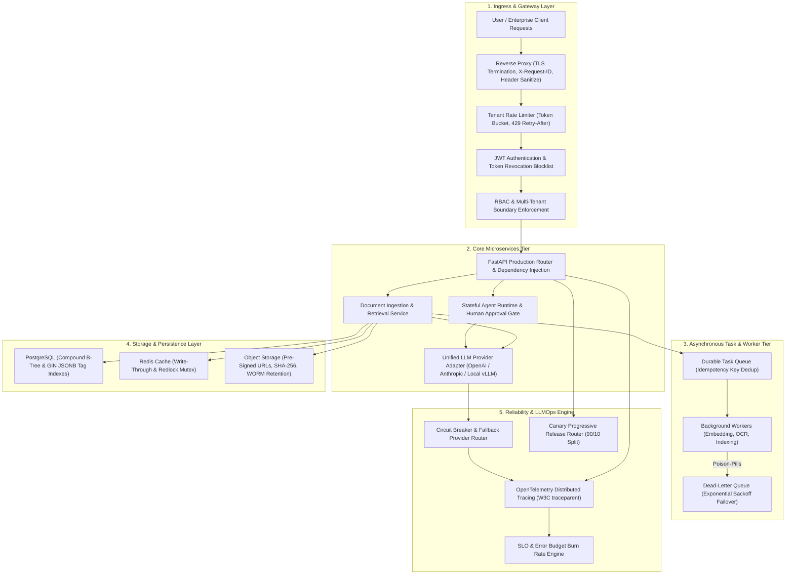

# 📅 Month 07 — Production Backend, Cloud & LLMOps Infrastructure

> **Focus:** Production API Architecture, Clean 3-Tier Layering, JWT Authentication, Multi-Tenant RBAC, PostgreSQL Relational Storage, Compound & GIN Indexing, Redis Caching & Distributed Redlocks, S3 Object Storage Lifecycle, Background Worker Queues, Celery & DLQs, Docker Hardening, Container Networking, Reverse Proxies, Cloud Deployment Topologies, Infrastructure as Code (IaC), CI/CD Automation, Canary Progressive Delivery, Secrets Vault Management, Token Bucket Rate Limiting, Autoscaling & Load Balancing, OpenTelemetry Distributed Tracing, SLO Alerting & Error Budget Burn Rates, Incident Response & Runbooks, Database Disaster Recovery (PITR/WAL), GDPR/HIPAA Privacy & Data Retention, Unified LLM Provider Adapters, GPU vs CPU Cost Economics, Production RAG & Agent Deployments, Security Supply-Chain Scanning, Chaos Engineering, and Production Readiness Reviews (PRR).
>
> **Major Project:** Project 7: Deployable Multi-Tenant GenAI Platform — Secure APIs, Background Ingestion Workers, Distributed Caching, Object Storage, Observability, and Progressive Cloud Delivery.

---

## 🏗️ Architecture: Multi-Tenant Enterprise GenAI Platform

---

## 🎯 Day-by-Day Implementation Plan (Day 01 – Day 31)

| Day | GenAI / LLMOps Infrastructure Topic | Key Deliverables (Python in `AI/`) | DSA & System Design (Java in `DSA/`) | Status |
|:---:|:------------------------------------|:-----------------------------------|:-------------------------------------|:------:|
| [Day 01](Day-01/) | **Production API Architecture** | `production_api_architecture.py` (Clean 3-tier layering, envelopes, pagination) | SOLID Principles in Java (`SolidOopDesign.java`) | ✅ Done |
| [Day 02](Day-02/) | **Authentication Fundamentals** | `jwt_auth_service.py` (HMAC-SHA256 JWT, password hashing, revocation) | Creational Patterns: Singleton & Builder (`CreationalPatterns.java`) | ✅ Done |
| [Day 03](Day-03/) | **Authorization & RBAC** | `rbac_authorization_service.py` (Multi-tenant boundaries, scope checks) | Behavioral Patterns: Strategy & Observer (`BehavioralPatterns.java`) | ✅ Done |
| [Day 04](Day-04/) | **Multi-Tenancy Data Isolation** | `multitenant_data_isolator.py` (Partitioned vector index, cross-tenant denial) | Structural Patterns: Adapter & Decorator (`StructuralPatterns.java`) | ✅ Done |
| [Day 05](Day-05/) | **PostgreSQL Schema & Indexing** | `postgres_schema_indexer.py` (Compound B-tree & GIN JSONB tag indexes) | Enterprise Exception Handling (`ExceptionHandlingFramework.java`) | ✅ Done |
| [Day 06](Day-06/) | **Redis Application Patterns** | `redis_cache_patterns.py` (Write-through cache, TTL, Redlock mutex) | Java NIO Stream Buffer Processing (`JavaNioFileStreamer.java`) | ✅ Done |
| [Day 07](Day-07/) | **Object Storage & File Lifecycle** | `object_storage_lifecycle.py` (S3 pre-signed URLs, SHA-256, retention purge) | JDBC Transaction Isolation Boundaries (`JdbcTransactionManager.java`) | ✅ Done |
| [Day 08](Day-08/) | **Background Queues & Workers** | `background_worker_queue.py` (Durable queue, idempotency, DLQ escalation) | SQL Window Functions & Top Earners (`SqlInterviewMastery.java`) | ✅ Done |
| [Day 09](Day-09/) | **Docker Production Practices** | `docker_production_hardener.py` (Multi-stage build parser, non-root linter) | Concurrency: Atomic CAS & CountDownLatch (`ConcurrencyRevisionMastery.java`) | ✅ Done |
| [Day 10](Day-10/) | **Container Networking & Proxies** | `reverse_proxy_gateway.py` (Routing, TLS termination, X-Request-ID) | Bounded Blocking Queue Backpressure (`BoundedBlockingQueueProducerConsumer.java`) | ✅ Done |
| [Day 11](Day-11/) | **Cloud Deployment Concepts** | `cloud_deployment_topology.py` (Multi-AZ HA cluster, GPU TCO monthly calculator) | JVM Memory Model & Pressure Diagnoser (`JvmMemoryModelDiagnoser.java`) | ✅ Done |
| [Day 12](Day-12/) | **Infrastructure as Code (IaC)** | `iac_config_manager.py` (Declarative state locking, drift detector) | Generational Garbage Collection (`GarbageCollectionAnalyzer.java`) | ✅ Done |
| [Day 13](Day-13/) | **CI Pipelines for LLMOps** | `ci_pipeline_validator.py` (Mandatory test stages, security eval steps) | Dynamic Class Loading & Reflection (`DynamicClassLoadingRuntime.java`) | ✅ Done |
| [Day 14](Day-14/) | **CD & Canary Release Strategy** | `progressive_release_canary.py` (Canary 90/10 traffic split, automated rollback) | Java Memory Allocation Profiling (`JavaAllocationProfiler.java`) | ✅ Done |
| [Day 15](Day-15/) | **Secrets Management & Vault** | `secrets_vault_manager.py` (Dynamic secret storage, regex log redactor) | Low-Level Design: Parking Lot (`ParkingLotLowLevelDesign.java`) | ✅ Done |
| [Day 16](Day-16/) | **API Rate Limiting & Quotas** | `tenant_quota_limiter.py` (Token bucket rate limiter, per-tenant burst quotas) | Low-Level Design: Elevator System (`ElevatorSystemLowLevelDesign.java`) | ✅ Done |
| [Day 17](Day-17/) | **Load Balancing & Autoscaling** | `load_balancer_autoscaler.py` (Least connections, queue depth autoscaler) | Low-Level Design: Rate Limiter (`RateLimiterLowLevelDesign.java`) | ✅ Done |
| [Day 18](Day-18/) | **OpenTelemetry Observability** | `opentelemetry_tracer.py` (W3C trace context, spans, LLM token metrics) | Low-Level Design: LRU Cache $O(1)$ (`DistributedCacheLowLevelDesign.java`) | ✅ Done |
| [Day 19](Day-19/) | **Dashboards, SLIs & Alerting** | `slo_alerting_engine.py` (Error budget burn rate, automated PagerDuty alert) | Low-Level Design: Task Scheduler (`TaskSchedulerLowLevelDesign.java`) | ✅ Done |
| [Day 20](Day-20/) | **Incident Response & Runbooks** | `incident_runbook_automator.py` (Circuit breaker tripping, failover timeline) | Low-Level Design: Notification Service (`NotificationServiceLowLevelDesign.java`) | ✅ Done |
| [Day 21](Day-21/) | **Database Backup & Disaster Recovery** | `database_disaster_recovery.py` (WAL archiving, PITR, RPO/RTO compliance) | Low-Level Design: Object Storage (`DistributedFileStorageLowLevelDesign.java`) | ✅ Done |
| [Day 22](Day-22/) | **Data Privacy & Retention** | `privacy_retention_enforcer.py` (PII scrubbing, GDPR data purging) | Low-Level Design: Resilient API Client (`ResilientApiClientLowLevelDesign.java`) | ✅ Done |
| [Day 23](Day-23/) | **LLM Provider Abstraction** | `unified_llm_provider.py` (Normalized token schemas, provider fallback cascade) | Custom JUnit Testing Framework (`JUnitTestingFrameworkMock.java`) | ✅ Done |
| [Day 24](Day-24/) | **GPU vs CPU Deployment Matrix** | `compute_deployment_matrix.py` (API vs Dedicated GPU TCO breakeven) | Code Review & Stream Refactoring (`CodeReviewRefactoringMock.java`) | ✅ Done |
| [Day 25](Day-25/) | **Production RAG Staging Service** | `production_rag_service.py` (Readiness probes, warmup cache, query engine) | Enterprise Immutability Patterns (`EnterpriseJavaCodingPatterns.java`) | ✅ Done |
| [Day 26](Day-26/) | **Production Agent Deployment** | `production_agent_deployment.py` (Stateful runtime, approval gates, sandboxing) | Concurrency Masterclass: Ring Buffer (`ConcurrencyInterviewMasterclass.java`) | ✅ Done |
| [Day 27](Day-27/) | **Security Testing & Supply Chain** | `security_pipeline_scanner.py` (Dependency CVE scanner, SBOM audit) | Composite Data Structure: RandomizedSet $O(1)$ (`CompositeDataStructureDesign.java`) | ✅ Done |
| [Day 28](Day-28/) | **Reliability & Chaos Engineering** | `chaos_reliability_engine.py` (Simulated 503 outages, degraded cache fallback) | Senior Java Backend Interview Mock (`JavaBackendInterviewMock.java`) | ✅ Done |
| [Day 29](Day-29/) | **Production Readiness Review** | `production_readiness_audit.py` (20-point operational PRR audit check) | System Design Mock: URL Shortener (`SystemDesignInterviewMock.java`) | ✅ Done |
| [Day 30](Day-30/) | **Project 7 Platform Release** | `project7_platform_release.py` (Production release manifest, service verification) | Capstone DSA Review: Autocomplete Trie (`CapstoneProductionDsaReview.java`) | ✅ Done |
| [Day 31](Day-31/) | **Enterprise LLMOps Benchmark** | `enterprise_llmops_benchmark.py` (Multi-tenant stress test, P99 latency profiler) | Lock-Free Michael-Scott Queue (`ConcurrentNonBlockingQueue.java`) | ✅ Done |

---

## 🏗️ Directory Architecture

Every day module strictly adheres to the established repository standard:
- `AI/` — **Python production microservices, workers, security linters, and cloud models.**
- `DSA/` — **Runnable Java solutions with comprehensive `main` verification test drivers.**
- `Interview/` — **Technical Q&A deep-dives covering systems design, architectures, and algorithm invariants.**
- `Notes/` — **Explanatory engineering notes detailing theory, architecture, and production trade-offs.**
- `README.md` — **Individual day guide with problem breakdown, folder layout, and run instructions.**
