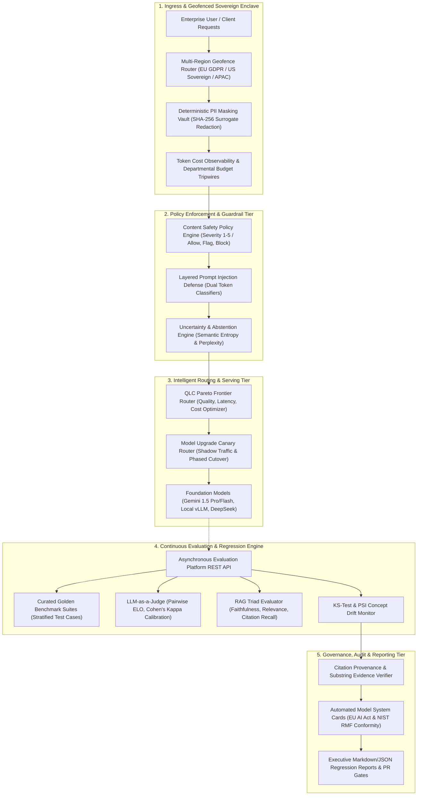

# 📅 Month 08 — Evaluation, Governance, Safety & Scale

> **Focus:** LLMOps Evaluation Platforms, Golden Test Datasets, LLM-as-a-Judge Calibration, RAG Triad Metrics (Faithfulness, Answer Relevance, Context Recall), Agent Trajectory Evaluation, Regression Testing & CI/CD Gates, Prompt A/B Testing, Experiment Tracking & Version Registries, Online Quality Monitoring, Concept & Data Drift Detection, Safety & Red Teaming Orchestration, Layered Prompt Injection Defenses, PII Masking & Re-identification Vaults, Model System Cards & EU AI Act Conformity, Content Moderation Policy Engines, Uncertainty Estimation & Selective Abstention, Citation Provenance Auditing, FinOps & Token Cost Observability, Quality-Latency-Cost (QLC) Pareto Frontiers, Capacity Planning & Little's Law GPU Sizing, Chaos Engineering for Model Outages, Multi-Region Sovereign Enclaves, Zero-Downtime Model Deprecation & Canary Upgrades, Evaluation REST APIs, Metric Trend Dashboards, Enterprise Governance Gateways, Capstone Project 8 Release, and Lock-Free Concurrent Data Structures.
>
> **Major Project:** Project 8: Enterprise LLMOps Evaluation, Governance & Safety Platform — Automated Regression Gating, Multi-Tiered Safety Taxonomy, Deterministic PII Surrogates, FinOps Observability, and Sovereign Regional Enclaves.

---

## 🏗️ Architecture: Enterprise LLMOps Evaluation & Governance Platform



---

## 📚 31-Day Master Curriculum

| Day | System Domain | Implementation Focus (Python) | Timed DSA Problem Set (Java) | Target Complexity |
| :--- | :--- | :--- | :--- | :--- |
| **Day 01** | Evaluation Strategy | `evaluation_strategy_planner.py` | `ArraysHashingTimedSet.java` (LC 1 Two Sum) | $O(N)$ Time, $O(N)$ Space |
| **Day 02** | Golden Datasets | `golden_dataset_governance.py` | `StringsFrequencyMaps.java` (LC 242 Valid Anagram) | $O(N)$ Time, $O(1)$ Space |
| **Day 03** | Human Eval & Rubrics | `human_evaluation_rubrics.py` | `TwoPointersTimedSet.java` (LC 15 3Sum) | $O(N^2)$ Time, $O(1)$ Space |
| **Day 04** | LLM-as-a-Judge Calibration | `llm_as_judge_calibration.py` | `SlidingWindowTimedSet.java` (LC 3 Longest Substring) | $O(N)$ Time, $O(\\min(N, M))$ Space |
| **Day 05** | RAG Triad Metrics | `rag_evaluation_metrics.py` | `PrefixSumSubarrays.java` (LC 560 Subarray Sum Equals K) | $O(N)$ Time, $O(N)$ Space |
| **Day 06** | Agent Trajectory Evaluation | `agent_evaluation_metrics.py` | `BinarySearchTimedSet.java` (LC 33 Search Rotated Array) | $O(\\log N)$ Time, $O(1)$ Space |
| **Day 07** | Regression Testing & CI Gates | `regression_gate_validator.py` | `LinkedListsTimedSet.java` (LC 206 Reverse Linked List) | $O(N)$ Time, $O(1)$ Space |
| **Day 08** | Prompt A/B Testing | `ab_testing_framework.py` | `StacksQueuesTimedSet.java` (LC 739 Daily Temperatures) | $O(N)$ Time, $O(N)$ Space |
| **Day 09** | Prompt Version Registry | `prompt_version_registry.py` | `BinaryTreesTimedSet.java` (LC 104 Max Depth) | $O(N)$ Time, $O(H)$ Space |
| **Day 10** | Experiment Tracking | `experiment_tracking_manifest.py` | `BstTimedSet.java` (LC 98 Validate BST) | $O(N)$ Time, $O(H)$ Space |
| **Day 11** | Online Quality Monitoring | `online_quality_monitor.py` | `HeapsTopKTimedSet.java` (LC 215 Kth Largest Element) | $O(N \\log K)$ Time, $O(K)$ Space |
| **Day 12** | Concept & Data Drift | `drift_detector_engine.py` | `GraphsBfsDfsTimedSet.java` (LC 200 Number of Islands) | $O(M \\times N)$ Time, $O(M \\times N)$ Space |
| **Day 13** | Safety Evaluation Datasets | `safety_eval_dataset_builder.py` | `GraphsShortestPathsTimedSet.java` (LC 743 Network Delay Time) | $O(E \\log V)$ Time, $O(V)$ Space |
| **Day 14** | Red Teaming Methodology | `red_teaming_orchestrator.py` | `TopologicalSortDsuTimedSet.java` (LC 210 Course Schedule II) | $O(V + E)$ Time, $O(V + E)$ Space |
| **Day 15** | Layered Injection Defenses | `layered_injection_defense.py` | `BacktrackingTimedSet.java` (LC 78 Subsets) | $O(N \\cdot 2^N)$ Time, $O(N)$ Space |
| **Day 16** | Privacy & PII Handling | `pii_masking_vault.py` | `DynamicProgramming1DTimedSet.java` (LC 198 House Robber) | $O(N)$ Time, $O(1)$ Space |
| **Day 17** | AI Governance & System Cards | `ai_governance_system_card.py` | `DynamicProgramming2DTimedSet.java` (LC 1143 Longest Common Subseq) | $O(M \\times N)$ Time, $O(\\min(M, N))$ Space |
| **Day 18** | Content Safety Policies | `content_safety_policy_engine.py` | `DynamicProgrammingAdvancedTimedSet.java` (LC 300 LIS) | $O(N \\log N)$ Time, $O(N)$ Space |
| **Day 19** | Uncertainty & Abstention | `uncertainty_abstention_engine.py` | `TrieBitManipulationTimedSet.java` (LC 208 Implement Trie) | $O(L)$ Time, $O(1)$ Space |
| **Day 20** | Citation & Provenance Audits | `citation_provenance_auditor.py` | `RangeQueryFenwickTree.java` (LC 307 Mutable Range Sum) | $O(\\log N)$ Time, $O(N)$ Space |
| **Day 21** | Cost Observability & Budgets | `cost_observability_engine.py` | `JavaCollectionsCostComplexity.java` (Collections Analysis) | $O(1)$ vs $O(N)$ Space/Time |
| **Day 22** | Pareto Frontier Optimization | `pareto_optimization_engine.py` | `BoundedConcurrencyLimiter.java` (Fair Semaphore Throttler) | $O(1)$ Acquire/Release |
| **Day 23** | Capacity & Little's Law Sizing | `capacity_queueing_analyzer.py` | `DistributedTaskQueueLowLevelDesign.java` (Priority Dispatcher) | $O(\\log N)$ Offer/Poll |
| **Day 24** | Chaos Testing & Fault Injection | `llmops_chaos_test_suite.py` | `MixedDsaMockA.java` (LC 42 Rain Water & LC 23 Merge K Lists) | $O(N)$ Time / $O(N \\log K)$ Time |
| **Day 25** | Multi-Region Sovereign Enclaves | `multi_region_residency_router.py` | `MixedDsaMockB.java` (LC 124 Tree Path Sum & LC 312 Burst Balloons) | $O(N)$ Time / $O(N^3)$ Time |
| **Day 26** | Model Deprecation & Canary | `model_upgrade_migration_plan.py` | `MixedDsaMockC.java` (LC 146 LRU Cache) | $O(1)$ Get and Put |
| **Day 27** | Evaluation Platform API | `evaluation_platform_api.py` | `AlgorithmCommunicationMock.java` (LC 84 Histogram & LC 72 Edit Dist) | $O(N)$ Time / $O(M \\times N)$ Time |
| **Day 28** | Evaluation Dashboards | `evaluation_dashboard_reporter.py` | `DsaWeakTopicRepair.java` (LC 85 Maximal Rect & LC 297 Tree Codec) | $O(R \\times C)$ Time / $O(N)$ Time |
| **Day 29** | Integrated Governance Gateway | `governance_project_integrator.py` | `FaangComprehensiveTimedMock.java` (LC 4 Median & LC 76 Min Window) | $O(\\log(\\min(M, N)))$ / $O(M+N)$ |
| **Day 30** | Capstone Project 8 Release | `project8_llmops_governance_release.py`| `DsaReadinessMasteryIndex.java` (LC 41 Missing Pos & LC 239 Window Max) | $O(N)$ Time, $O(1)$ / $O(K)$ Space |
| **Day 31** | Platform Concurrency Benchmark | `enterprise_governance_benchmark.py` | `LockFreeTreiberStack.java` (AtomicReference Non-blocking CAS) | Lock-Free $O(1)$ CAS |

---

## 📂 Directory Architecture

```
Month-08/
├── Day-01/ ... Day-31/
│   ├── AI/
│   │   └── <system_service_or_eval_module>.py
│   ├── DSA/
│   │   └── <AlgorithmSolutionTimedSet>.java
│   ├── Interview/
│   │   └── technical_questions.md
│   ├── Notes/
│   │   └── notes.md
│   └── README.md
└── README.md
```

---

## 🚀 Verification & Testing Suite

All 31 Python evaluation and governance microservices execute standalone with zero external dependencies. All 31 Java timed DSA solutions compile and verify with native Java assertions:

```bash
# 1. Verify all 31 AI microservices
python -c "import glob, subprocess; [subprocess.run(['python', p], check=True) for p in sorted(glob.glob('Month-08/**/AI/*.py', recursive=True))]"

# 2. Compile and test all 31 Java DSA implementations
python -c "import glob, subprocess, os; [subprocess.run(['javac', j], check=True) for j in sorted(glob.glob('Month-08/**/DSA/*.java', recursive=True))]; [os.remove(c) for c in glob.glob('Month-08/**/DSA/*.class', recursive=True)]"
```
