# 📅 Month 09 — Distributed Pretraining & High-Performance Scaling (100% Completed ✅)

> **Focus:** Large-scale distributed pretraining from first principles: Byte-Pair Encoding (BPE) vocabulary training, sharded binary memory-mapped streaming dataloaders, Distributed Data Parallelism (DDP) Ring All-Reduce, Megatron-LM Tensor Parallelism (TP) column/row linear layers, Pipeline Parallelism (PP) 1F1B schedules, DeepSpeed ZeRO-1/2/3 memory partitioning, PyTorch Fully Sharded Data Parallel (FSDP), Activation Checkpointing trade-offs, 3D Parallelism (DP + TP + PP) cluster orchestration, GPU memory hierarchy (HBM vs SRAM), FlashAttention mathematical tiling & online softmax, OpenAI Triton custom GPU kernel programming, Mixture of Experts (MoE) Top-K Gating, Sequence Parallelism (Megatron-SP), RingAttention Context Parallelism, FP8/BF16 Mixed Precision, Asynchronous Distributed Checkpointing (DCP), Collective Communication Topologies, Pretraining Execution Loops with Cosine Warmup, Elastic Fault Tolerance, Hardware MFU Profiling, and Pretraining Evaluation (Perplexity & Bits-Per-Byte).
>
> **Major Capstone:** Production Distributed Pretraining Cluster Infrastructure — Multi-dimensional scaling, zero-bubble pipeline scheduling, MoE expert parallelism, and hardware-efficient custom kernel fusion.

---

## 🏗️ Architecture: Distributed Pretraining & 3D Parallelism Engine

```mermaid
flowchart TD
    subgraph DataIngestion["1. Distributed Data Ingestion Layer"]
        Corpus["Raw Web/Code Token Corpus"]
        BPETrainer["Byte-Pair Encoding (BPE) Vocab Trainer"]
        BinaryWriter["Binary Sharded Tokenizer (.bin / .idx)"]
        StreamLoader["Sharded Streaming DataLoader (Zero-Copy mmap)"]
    end

    subgraph ThreeDGrid["2. 3D Parallelism Grid & Scaling"]
        CartesianCoord["3D Cartesian Communicator (NVLink vs InfiniBand)"]
        ColRowTP["Megatron TP: Column & Row Parallel Linear Projections"]
        SeqParallel["Megatron-SP: Sequence Parallel LayerNorm/Dropout"]
        PipelineSchedule["1F1B Pipeline Scheduler (Activation Stashing)"]
        RingReduce["DDP Ring All-Reduce & Gradient Bucketing"]
    end

    subgraph SparseAndContext["3. MoE & Long-Context Tier"]
        MoERouter["MoE Top-2 Gating Router (Auxiliary Balancing Loss)"]
        RingAttn["RingAttention Context Parallelism (Circular KV Transfer)"]
        AllToAllComm["All-to-All Token Dispatch & Combine"]
    end

    subgraph MemoryEngine["4. Memory Optimization Tier"]
        ZeROStage["ZeRO-1 / ZeRO-2 / ZeRO-3 Partitioning"]
        FSDPWrapper["PyTorch FSDP (Layer-by-layer All-Gather & Discard)"]
        ActCheckpoint["Activation Checkpointing (33% Compute Trade-off)"]
        AsyncDCP["Asynchronous Distributed Checkpointing (DCP)"]
    end

    subgraph KernelCompute["5. High-Performance Compute & Reliability"]
        FlashAttn["FlashAttention (SRAM Tiling & Online Softmax)"]
        TritonKernels["OpenAI Triton Custom Fused Kernels (Fused Add + RMSNorm)"]
        FaultEngine["TorchElastic Fault Tolerance & Straggler Eviction"]
        MFUProfiler["Hardware MFU & Perplexity Evaluation Engine"]
    end

    Corpus --> BPETrainer
    BPETrainer --> BinaryWriter
    BinaryWriter --> StreamLoader
    StreamLoader --> CartesianCoord
    CartesianCoord --> ColRowTP
    ColRowTP --> SeqParallel
    SeqParallel --> PipelineSchedule
    PipelineSchedule --> RingReduce
    RingReduce --> MoERouter
    MoERouter --> AllToAllComm
    AllToAllComm --> RingAttn
    RingAttn --> ZeROStage
    ZeROStage --> FSDPWrapper
    FSDPWrapper --> ActCheckpoint
    ActCheckpoint --> AsyncDCP
    AsyncDCP --> FlashAttn
    FlashAttn --> TritonKernels
    TritonKernels --> FaultEngine
    FaultEngine --> MFUProfiler
```



---

## 📚 Master Curriculum (Days 01–20 Complete — 100% Curriculum Completed ✅)

| Day | Distributed Pretraining Topic | Implementation Focus (Python) | Timed DSA Problem Set (Java) | Target Complexity |
| :--- | :--- | :--- | :--- | :--- |
| **Day 01** | BPE Tokenizer Pretraining | `bpe_tokenizer_trainer.py` (Vocab merges, byte fallback) | `KnapsackZeroOneTimedSet.java` (LC 416 Partition Equal Subset) | $O(N \\cdot W)$ Time, $O(W)$ Space |
| **Day 02** | Sharded Streaming DataLoaders | `sharded_streaming_dataloader.py` (Binary chunking, mmap) | `BellmanFordShortestPath.java` (LC 787 Cheapest Flights) | $O(K \\cdot E)$ Time, $O(V)$ Space |
| **Day 03** | DDP Ring All-Reduce | `ddp_ring_allreduce.py` (Scatter-Reduce & All-Gather ring) | `FloydWarshallAllPairs.java` (LC 1334 Smallest Neighbors) | $O(V^3)$ Time, $O(V^2)$ Space |
| **Day 04** | Megatron-LM Tensor Parallelism | `megatron_tensor_parallel.py` (Column & row parallel layers) | `PrimsMinimumSpanningTree.java` (LC 1584 Connect Points) | $O(E \\log V)$ Time, $O(V)$ Space |
| **Day 05** | Pipeline Parallelism & 1F1B | `pipeline_parallel_scheduler.py` (1F1B schedule, bubble ratio) | `KruskalsDisjointSetMst.java` (LC 1135 Connect Cities DSU) | $O(E \\log E)$ Time, $O(V)$ Space |
| **Day 06** | ZeRO-1, 2, 3 Memory Partitioner| `zero_memory_partitioner.py` (16B/param breakdown, VRAM scaling)| `TrieWildcardAutocomplete.java` (LC 211 Add and Search Words) | $O(26^M)$ Time, $O(M)$ Space |
| **Day 07** | PyTorch FSDP & Checkpointing | `fsdp_activation_checkpointing.py` (Layer unshard, recompute) | `SegmentTreeRangeMinimumQuery.java` (Segment Tree RMQ) | $O(\\log N)$ Update/Query |
| **Day 08** | 3D Parallelism Orchestrator | `three_d_parallelism_orchestrator.py` (Grid coords, groups) | `TopologicalSortKahnsAlgo.java` (LC 210 Course Schedule II) | $O(V + E)$ Time, $O(V + E)$ Space |
| **Day 09** | FlashAttention Tiled Softmax | `flash_attention_simulator.py` (Online softmax, SRAM tiling) | `KmpStringMatching.java` (LC 28 strStr LPS Matching) | $O(N + M)$ Time, $O(M)$ Space |
| **Day 10** | Triton GPU Custom Kernels | `triton_kernel_simulator.py` (Block pointers, fused RMSNorm) | `RabinKarpRollingHash.java` (LC 187 Repeated DNA Sequences) | $O(N)$ Time, $O(N)$ Space |
| **Day 11** | Mixture of Experts (MoE) | `moe_expert_router.py` (Top-2 gating, capacity factor, aux loss) | `EditDistanceTimedSet.java` (LC 72 Edit Distance DP) | $O(M \\cdot N)$ Time, $O(\\min(M, N))$ Space |
| **Day 12** | Megatron Sequence Parallelism | `megatron_sequence_parallel.py` (Activation sharding $s / tp$) | `HierholzersEulerianPath.java` (LC 332 Reconstruct Itinerary) | $O(E \\log E)$ Time, $O(V + E)$ Space |
| **Day 13** | RingAttention Context Parallel | `ring_attention_simulator.py` (Circular KV transfer, million tokens) | `LongestValidParenthesesTimedSet.java` (LC 32 Valid Parentheses) | $O(N)$ Time, $O(1)$ Space |
| **Day 14** | Mixed Precision Stability | `mixed_precision_numerical_stability.py` (BF16, FP8 E4M3/E5M2) | `LargestRectangleHistogramTimedSet.java` (LC 84 Monotonic Stack) | $O(N)$ Time, $O(N)$ Space |
| **Day 15** | Distributed Checkpointing (DCP)| `distributed_async_checkpointing.py` (Sharded async storage) | `MaximalRectangleTimedSet.java` (LC 85 Maximal Rectangle) | $O(R \\cdot C)$ Time, $O(C)$ Space |
| **Day 16** | Collective Topologies | `collective_communication_topology.py` (All-to-All, NVLink vs IB) | `SlidingWindowMaximumTimedSet.java` (LC 239 Monotonic Deque) | $O(N)$ Time, $O(K)$ Space |
| **Day 17** | Megatron Pretraining Loop | `megatron_pretraining_engine.py` (Cosine warmup, norm clipping) | `RotatedArrayMinBinarySearch.java` (LC 154 Rotated Array II) | $O(\\log N)$ Avg, $O(N)$ Worst |
| **Day 18** | Elastic Fault Tolerance | `elastic_fault_tolerance_engine.py` (Heartbeat, straggler eviction) | `BurstBalloonsTimedSet.java` (LC 312 Interval DP) | $O(N^3)$ Time, $O(N^2)$ Space |
| **Day 19** | Hardware MFU Profiling | `hardware_profiling_mfu_analyzer.py` (6P rule, Roofline MFU/HFU) | `NQueensBacktrackingTimedSet.java` (LC 52 Bitwise N-Queens) | $O(N!)$ Time, $O(N)$ Space |
| **Day 20** | Pretraining Evaluation Suite | `pretraining_eval_suite.py` (Perplexity, Bits-Per-Byte BPB) | `AccountsMergeDisjointSet.java` (LC 721 Accounts Merge DSU) | $O(N \\cdot K \\log(N \\cdot K))$ Time |

---

## 🚀 Verification & Benchmarking Suite

Run the complete test suite and performance benchmark for Month 09:

```bash
# 1. Run all 20 Python AI pretraining microservices
python -c "import glob, subprocess; [subprocess.run(['python', p], check=True) for p in sorted(glob.glob('Month-09/**/AI/*.py', recursive=True))]"

# 2. Compile and test all 20 Java DSA implementations
python -c "import glob, subprocess, os; [subprocess.run(['javac', j], check=True) for j in sorted(glob.glob('Month-09/**/DSA/*.java', recursive=True))]; [os.remove(c) for c in glob.glob('Month-09/**/DSA/*.class', recursive=True)]"

# 3. Run automated integration test suite
python Month-09/tests/test_distributed_days11_20.py

# 4. Run distributed scaling benchmark profiler
python Month-09/benchmarks/benchmark_distributed_scaling.py
```
