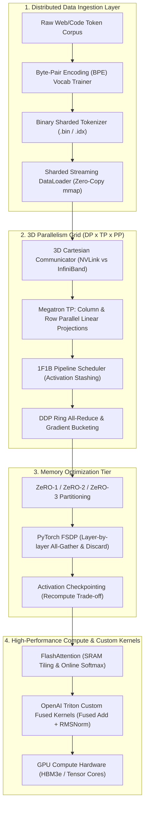

# 📅 Month 09 — Distributed Pretraining & High-Performance Scaling

> **Focus:** Large-scale distributed pretraining from first principles: Byte-Pair Encoding (BPE) vocabulary training, sharded binary memory-mapped streaming dataloaders, Distributed Data Parallelism (DDP) Ring All-Reduce, Megatron-LM Tensor Parallelism (TP) column/row linear layers, Pipeline Parallelism (PP) 1F1B schedules, DeepSpeed ZeRO-1/2/3 memory partitioning, PyTorch Fully Sharded Data Parallel (FSDP), Activation Checkpointing trade-offs, 3D Parallelism (DP + TP + PP) cluster orchestration, GPU memory hierarchy (HBM vs SRAM), FlashAttention mathematical tiling & online softmax, OpenAI Triton custom GPU kernel programming, and advanced algorithmic mastery in Java.
>
> **Major Capstone:** Production Distributed Pretraining Cluster Infrastructure — Multi-dimensional scaling, zero-bubble pipeline scheduling, and hardware-efficient custom kernel fusion.

---

## 🏗️ Architecture: Distributed Pretraining & 3D Parallelism Engine



---

## 📚 Master Curriculum (Days 01–10 Completed ✅)

| Day | Distributed Pretraining Topic | Implementation Focus (Python) | Timed DSA Problem Set (Java) | Target Complexity |
| :--- | :--- | :--- | :--- | :--- |
| **Day 01** | BPE Tokenizer Pretraining | `bpe_tokenizer_trainer.py` (Vocab merges, byte fallback) | `KnapsackZeroOneTimedSet.java` (LC 416 Partition Equal Subset) | $O(N \\cdot W)$ Time, $O(W)$ Space |
| **Day 02** | Sharded Streaming DataLoaders | `sharded_streaming_dataloader.py` (Binary chunking, mmap) | `BellmanFordShortestPath.java` (LC 787 Cheapest Flights) | $O(K \\cdot E)$ Time, $O(V)$ Space |
| **Day 03** | DDP Ring All-Reduce | `ddp_ring_allreduce.py` (Scatter-Reduce & All-Gather ring) | `FloydWarshallAllPairs.java` (LC 1334 Smallest Neighbors) | $O(V^3)$ Time, $O(V^2)$ Space |
| **Day 04** | Megatron-LM Tensor Parallelism | `megatron_tensor_parallel.py` (Column & row parallel layers) | `PrimsMinimumSpanningTree.java` (LC 1584 Connect Points) | $O(E \\log V)$ Time, $O(V)$ Space |
| **Day 05** | Pipeline Parallelism & 1F1B | `pipeline_parallel_scheduler.py` (1F1B schedule, bubble ratio) | `KruskalsDisjointSetMst.java` (LC 1135 Connect Cities DSU) | $O(E \\log E)$ Time, $O(V)$ Space |
| **Day 06** | ZeRO-1, 2, 3 Memory Partitioner| `zero_memory_partitioner.py` (16B/param breakdown, VRAM scaling)| `TrieWildcardAutocomplete.java` (LC 211 Add and Search Words) | $O(26^M)$ Time, $O(M)$ Space |
| **Day 07** | PyTorch FSDP & Checkpointing | `fsdp_activation_checkpointing.py` (Layer unshard, recompute) | `SegmentTreeRangeMinimumQuery.java` (Segment Tree RMQ) | $O(\\log N)$ Update/Query |
| **Day 08** | 3D Parallelism Orchestrator | `three_d_parallelism_orchestrator.py` (Grid coords, groups) | `TopologicalSortKahnsAlgo.java` (LC 210 Course Schedule II) | $O(V + E)$ Time, $O(V + E)$ Space |
| **Day 09** | FlashAttention Tiled Softmax | `flash_attention_simulator.py` (Online softmax, SRAM tiling) | `KmpStringMatching.java` (LC 28 strStr LPS Matching) | $O(N + M)$ Time, $O(M)$ Space |
| **Day 10** | Triton GPU Custom Kernels | `triton_kernel_simulator.py` (Block pointers, fused RMSNorm) | `RabinKarpRollingHash.java` (LC 187 Repeated DNA Sequences) | $O(N)$ Time, $O(N)$ Space |

---

## 🚀 Verification Suite

All Python pretraining modules execute standalone with 0 dependencies. All Java timed DSA solutions compile and verify with native Java assertions:

```bash
# 1. Run all Python AI distributed modules
python -c "import glob, subprocess; [subprocess.run(['python', p], check=True) for p in sorted(glob.glob('Month-09/**/AI/*.py', recursive=True))]"

# 2. Compile and test all Java DSA implementations
python -c "import glob, subprocess, os; [subprocess.run(['javac', j], check=True) for j in sorted(glob.glob('Month-09/**/DSA/*.java', recursive=True))]; [os.remove(c) for c in glob.glob('Month-09/**/DSA/*.class', recursive=True)]"
```
