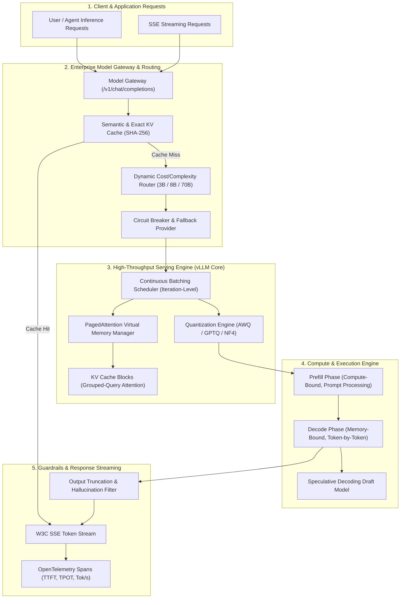
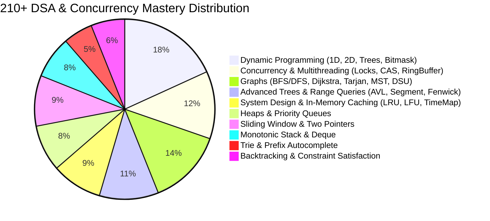

# 🤖 GenAI Engineer Roadmap — 9-Month Production Journey

<div align="center">

[](https://www.python.org/)
[](https://www.oracle.com/java/)
[](https://pytorch.org/)
[](https://vllm.ai/)
[](https://fastapi.tiangolo.com/)
[](https://www.docker.com/)
[](https://modelcontextprotocol.io/)
[](#-comprehensive-progress-tracker)
[](https://opensource.org/licenses/MIT)

<p align="center">
  <b>Architecting scalable, production-grade Generative AI systems from first principles.</b><br>
  Covering Foundation Models, Advanced RAG v2, ReAct Multi-Agent Swarms, Model Context Protocol (MCP), Supervised Fine-Tuning (SFT & LoRA/QLoRA), High-Throughput Inference Serving (vLLM, Continuous Batching, PagedAttention), Distributed Systems, and Daily LeetCode/Production DSA in Java.
</p>

</div>

---

## 📈 Executive Dashboard & Metrics

<div align="center">

| 🗓️ Total Days Completed | 🧠 Production AI Services | ☕ Java DSA & Concurrency | 🛡️ Security, Evals & Guardrails | 🏆 Roadmap Status |
|:---:|:---:|:---:|:---:|:---:|
| **246 Days** | **260+ Microservices** | **310+ Algorithms & Patterns** | **125+ Defense & Scaling Patterns** | **Month 09 in Progress (Days 01–10 Complete) 🚀** |

```mermaid
flowchart LR
    subgraph Evolution["🗺️ 9-Month GenAI Engineering Evolution Roadmap"]
        direction LR
        M1["<b>Month 01</b><br/>Foundations & OOP<br/>• Python, Groq, ChromaDB<br/>• RAG, FastAPI, SQLite<br/><b>Status: Completed ✅</b>"]
        M2["<b>Month 02</b><br/>Fine-Tuning & Security<br/>• LoRA, PEFT, Docker<br/>• Guardrails, Circuit Breaker<br/><b>Status: Completed ✅</b>"]
        M3["<b>Month 03</b><br/>Advanced RAG & Search<br/>• Hybrid BM25 & Dense RRF<br/>• Cross-Encoders, GraphRAG<br/><b>Status: Completed ✅</b>"]
        M4["<b>Month 04</b><br/>Agents & MCP Swarms<br/>• ReAct, Planner-Executor<br/>• JSON-RPC 2.0, HITL Gates<br/><b>Status: Completed ✅</b>"]
        M5["<b>Month 05</b><br/>SFT & Inference Engine<br/>• Masked Loss, DPO, AWQ<br/>• vLLM, PagedAttention<br/><b>Status: Completed ✅</b>"]
        M6["<b>Month 06</b><br/>Multimodal & Voice AI<br/>• VLM APIs, Layout Parser<br/>• VAD, Whisper, Video RAG<br/><b>Status: Completed ✅</b>"]
        M7["<b>Month 07</b><br/>Cloud & LLMOps Infra<br/>• Multi-Tenant APIs, Docker<br/>• Redis, Celery, OTel, Canary<br/><b>Status: Completed ✅</b>"]
        M8["<b>Month 08</b><br/>Evals & Governance<br/>• LLM-Judge, RAG Triad, PII<br/>• FinOps, Multi-Region, Chaos<br/><b>Status: Completed ✅</b>"]
        M9["<b>Month 09</b><br/>Distributed Pretraining<br/>• Megatron-LM, ZeRO-3<br/>• FSDP, Triton Kernels<br/><b>Status: In Progress 🚀</b>"]

        M1 --> M2 --> M3 --> M4 --> M5 --> M6 --> M7 --> M8 --> M9
    end
```

</div>



---

## 🏗️ Production Architecture — High-Throughput Model Serving & Inference Pipeline

The diagram below reflects the unified enterprise inference pipeline engineered across **Month 05**:



---

## 📁 Repository Directory Architecture

Every daily curriculum strictly follows this modular, enterprise layout:

```
Day-XX/
├── AI/                          # 🧠 Python GenAI Services, Engines, Trainers & Pipelines
│   └── <service_module>.py      # Standalone, runnable enterprise implementation
├── DSA/                         # ☕ Runnable Java DSA Solutions with Comprehensive Test Drivers
│   └── <ProblemSolution>.java   # Java 17+ implementations with time & space complexity analysis
├── Interview/                   # 🎯 Technical Interview Preparation
│   └── technical_questions.md   # Systems design, architectural trade-offs, and algorithm invariants
├── Notes/                       # 📝 Deep-Dive Theory & Curriculums
│   └── notes.md                 # Theoretical proofs, formulas, and production architectural notes
└── README.md                    # Root daily markdown guide with execution instructions
```

---

## 🗓️ Comprehensive Progress Tracker

### ⚡ Month 09 — Distributed Pretraining & High-Performance Scaling (Days 01–10 Complete 🚀)

| Day | Distributed Pretraining & GPU Kernel Topic | Key Deliverables (Python in `AI/`) | Timed DSA Problem Set (Java in `DSA/`) | Status |
|:---:|:-------------------------------------------|:-----------------------------------|:---------------------------------------|:------:|
| [Day 01](Month-09/Day-01/) | **BPE Tokenizer Pretraining** | `bpe_tokenizer_trainer.py` (Byte fallback, iterative pair merges) | 0/1 Knapsack: Partition Equal Subset LC 416 (`KnapsackZeroOneTimedSet.java`) | ✅ Done |
| [Day 02](Month-09/Day-02/) | **Sharded Streaming DataLoaders** | `sharded_streaming_dataloader.py` (Binary chunking, mmap, rank hashing) | Bellman-Ford: Cheapest Flights Within K Stops LC 787 (`BellmanFordShortestPath.java`) | ✅ Done |
| [Day 03](Month-09/Day-03/) | **DDP Ring All-Reduce** | `ddp_ring_allreduce.py` (Scatter-Reduce & All-Gather simulation) | Floyd-Warshall: Smallest Neighbors at Threshold LC 1334 (`FloydWarshallAllPairs.java`) | ✅ Done |
| [Day 04](Month-09/Day-04/) | **Megatron-LM Tensor Parallelism** | `megatron_tensor_parallel.py` (Column & row parallel projections, GeLU) | Prim's Algorithm: Min Cost to Connect All Points LC 1584 (`PrimsMinimumSpanningTree.java`) | ✅ Done |
| [Day 05](Month-09/Day-05/) | **Pipeline Parallelism & 1F1B** | `pipeline_parallel_scheduler.py` (1F1B scheduling, bubble calculations) | Kruskal's Algorithm & DSU: Connecting Cities LC 1135 (`KruskalsDisjointSetMst.java`) | ✅ Done |
| [Day 06](Month-09/Day-06/) | **ZeRO Memory Optimization (1/2/3)** | `zero_memory_partitioner.py` (16B/param breakdown, VRAM scaling) | Trie with Wildcard Matching: Add & Search Words LC 211 (`TrieWildcardAutocomplete.java`) | ✅ Done |
| [Day 07](Month-09/Day-07/) | **PyTorch FSDP & Checkpointing** | `fsdp_activation_checkpointing.py` (Layer-by-layer unshard, recompute) | Segment Tree: Range Minimum Query O(log N) (`SegmentTreeRangeMinimumQuery.java`) | ✅ Done |
| [Day 08](Month-09/Day-08/) | **3D Parallelism Orchestrator** | `three_d_parallelism_orchestrator.py` (3D Cartesian grid, group mapping) | Kahn's Topological Sort: Course Schedule II LC 210 (`TopologicalSortKahnsAlgo.java`) | ✅ Done |
| [Day 09](Month-09/Day-09/) | **FlashAttention Tiled Softmax** | `flash_attention_simulator.py` (Online softmax, SRAM tiling, O(N) memory)| KMP Algorithm: Find First Occurrence in String LC 28 (`KmpStringMatching.java`) | ✅ Done |
| [Day 10](Month-09/Day-10/) | **Triton GPU Custom Kernels** | `triton_kernel_simulator.py` (Block pointers, fused Add + RMSNorm) | Rabin-Karp Algorithm: Repeated DNA Sequences LC 187 (`RabinKarpRollingHash.java`) | ✅ Done |

---

### 🛡️ Month 08 — Evaluation, Governance, Safety & Scale (100% Completed ✅)

| Day | GenAI / Governance & Eval Topic | Key Deliverables (Python in `AI/`) | Timed DSA Problem Set (Java in `DSA/`) | Status |
|:---:|:--------------------------------|:-----------------------------------|:---------------------------------------|:------:|
| [Day 01](Month-08/Day-01/) | **Evaluation Strategy & Architecture** | `evaluation_strategy_planner.py` (Curated test suites, LLM-as-judge matrix) | Arrays & Hashing: Two Sum LC 1 (`ArraysHashingTimedSet.java`) | ✅ Done |
| [Day 02](Month-08/Day-02/) | **Golden Datasets & Annotation** | `golden_dataset_governance.py` (Dataset schema, Cohen's Kappa, stratified split) | Strings & Frequency: Valid Anagram LC 242 (`StringsFrequencyMaps.java`) | ✅ Done |
| [Day 03](Month-08/Day-03/) | **Human Evaluation & Rubrics** | `human_evaluation_rubrics.py` (Likert scoring, inter-annotator agreement) | Two Pointers: 3Sum LC 15 (`TwoPointersTimedSet.java`) | ✅ Done |
| [Day 04](Month-08/Day-04/) | **LLM-as-a-Judge Calibration** | `llm_as_judge_calibration.py` (Pairwise ELO, position bias, rubric grounding) | Sliding Window: Longest Substring LC 3 (`SlidingWindowTimedSet.java`) | ✅ Done |
| [Day 05](Month-08/Day-05/) | **RAG Evaluation Metrics** | `rag_evaluation_metrics.py` (RAG triad: faithfulness, answer relevance, context) | Prefix Sum: Subarray Sum Equals K LC 560 (`PrefixSumSubarrays.java`) | ✅ Done |
| [Day 06](Month-08/Day-06/) | **Agent Evaluation & Trajectory** | `agent_evaluation_metrics.py` (Tool call precision, step efficiency, loop detection) | Binary Search: Search Rotated Array LC 33 (`BinarySearchTimedSet.java`) | ✅ Done |
| [Day 07](Month-07/Day-07/) | **Regression Testing & CI Gates** | `regression_gate_validator.py` (Automated PR gate, regression delta budget) | Linked Lists: Reverse Linked List LC 206 (`LinkedListsTimedSet.java`) | ✅ Done |
| [Day 08](Month-08/Day-08/) | **Prompt A/B Testing & Analysis** | `ab_testing_framework.py` (Frequentist Z-score, sample sizing, power analysis) | Stacks & Monotonic Queues: Daily Temps LC 739 (`StacksQueuesTimedSet.java`) | ✅ Done |
| [Day 09](Month-08/Day-09/) | **Prompt Version Registry** | `prompt_version_registry.py` (Immutable SHA-256 prompts, rollback manager) | Binary Trees: Maximum Depth LC 104 (`BinaryTreesTimedSet.java`) | ✅ Done |
| [Day 10](Month-08/Day-10/) | **Experiment Tracking Manifests** | `experiment_tracking_manifest.py` (Lineage logging, parameter diffing) | BST: Validate Binary Search Tree LC 98 (`BstTimedSet.java`) | ✅ Done |
| [Day 11](Month-08/Day-11/) | **Online Quality Monitoring** | `online_quality_monitor.py` (Production sampling, thumbs up/down, latency drift) | Heaps & Priority Queues: Kth Largest LC 215 (`HeapsTopKTimedSet.java`) | ✅ Done |
| [Day 12](Month-08/Day-12/) | **Data & Concept Drift Detection** | `drift_detector_engine.py` (KS-Test, PSI drift scores, feature divergence) | Graphs BFS & DFS: Number of Islands LC 200 (`GraphsBfsDfsTimedSet.java`) | ✅ Done |
| [Day 13](Month-08/Day-13/) | **Safety Evaluation Datasets** | `safety_eval_dataset_builder.py` (Adversarial jailbreaks, refusal rubrics) | Graphs Shortest Path: Network Delay LC 743 (`GraphsShortestPathsTimedSet.java`) | ✅ Done |
| [Day 14](Month-08/Day-14/) | **Red Teaming Methodology** | `red_teaming_orchestrator.py` (Automated attack mutation, vulnerability scoring) | Topological Sort & DSU: Course Schedule LC 210 (`TopologicalSortDsuTimedSet.java`) | ✅ Done |
| [Day 15](Month-08/Day-15/) | **Layered Prompt Injection Defenses**| `layered_injection_defense.py` (Dual-layer token classifier, delimiter escaping) | Backtracking: Subsets LC 78 (`BacktrackingTimedSet.java`) | ✅ Done |
| [Day 16](Month-08/Day-16/) | **Privacy & PII Handling** | `pii_masking_vault.py` (Deterministic surrogate tokenization, demasking vault) | 1D Dynamic Programming: House Robber LC 198 (`DynamicProgramming1DTimedSet.java`) | ✅ Done |
| [Day 17](Month-08/Day-17/) | **AI Governance & System Cards** | `ai_governance_system_card.py` (EU AI Act & NIST RMF schemas, readiness scoring) | 2D Dynamic Programming: LCS LC 1143 (`DynamicProgramming2DTimedSet.java`) | ✅ Done |
| [Day 18](Month-08/Day-18/) | **Policy Enforcement & Safety** | `content_safety_policy_engine.py` (Multi-category taxonomy, severity gatekeeper) | Advanced DP: Longest Increasing Subseq LC 300 (`DynamicProgrammingAdvancedTimedSet.java`) | ✅ Done |
| [Day 19](Month-08/Day-19/) | **Uncertainty & Abstention** | `uncertainty_abstention_engine.py` (Semantic entropy, token logprob perplexity) | Trie & Bit Manipulation: Implement Trie LC 208 (`TrieBitManipulationTimedSet.java`) | ✅ Done |
| [Day 20](Month-08/Day-20/) | **Citation & Provenance Audits** | `citation_provenance_auditor.py` (RAG claim extraction, attribution precision) | Range Queries: Fenwick Tree LC 307 (`RangeQueryFenwickTree.java`) | ✅ Done |
| [Day 21](Month-08/Day-21/) | **Cost Observability & Budgets** | `cost_observability_engine.py` (Token cost accounting, budget tripwires) | Java Collections Cost & Amortized Analysis (`JavaCollectionsCostComplexity.java`) | ✅ Done |
| [Day 22](Month-08/Day-22/) | **Pareto Optimization (QLC)** | `pareto_optimization_engine.py` (Non-dominated frontier: Quality, Latency, Cost) | Concurrency: Bounded Concurrency Limiter (`BoundedConcurrencyLimiter.java`) | ✅ Done |
| [Day 23](Month-08/Day-23/) | **Capacity & Queueing Analysis** | `capacity_queueing_analyzer.py` (Little's Law, M/M/c queueing, GPU cluster sizing) | Low-Level Design: Priority Task Queue (`DistributedTaskQueueLowLevelDesign.java`) | ✅ Done |
| [Day 24](Month-08/Day-24/) | **Failure & Chaos Testing** | `llmops_chaos_test_suite.py` (Network latency, 429 quota exhaustion simulation) | Mixed Hard Mock A: Rain Water & Merge K Lists (`MixedDsaMockA.java`) | ✅ Done |
| [Day 25](Month-08/Day-25/) | **Multi-Region Data Residency** | `multi_region_residency_router.py` (Geofenced enclaves: EU GDPR, US, APAC) | Mixed Hard Mock B: Binary Tree Max Path & Balloons (`MixedDsaMockB.java`) | ✅ Done |
| [Day 26](Month-08/Day-26/) | **Model Deprecation & Canary** | `model_upgrade_migration_plan.py` (Zero-downtime cutover, shadow traffic canary) | Mixed Hard Mock C: LRU Cache LC 146 (`MixedDsaMockC.java`) | ✅ Done |
| [Day 27](Month-08/Day-27/) | **Evaluation Platform API** | `evaluation_platform_api.py` (Asynchronous REST API, CI/CD commit gate check) | Monotonic Stack & Edit Distance LC 84 & 72 (`AlgorithmCommunicationMock.java`) | ✅ Done |
| [Day 28](Month-08/Day-28/) | **Evaluation Dashboards** | `evaluation_dashboard_reporter.py` (Executive Markdown report, delta tracking) | Weak Topic Repair: Maximal Rectangle LC 85 & Tree Codec LC 297 (`DsaWeakTopicRepair.java`) | ✅ Done |
| [Day 29](Month-08/Day-29/) | **Governance Platform Integrator** | `governance_project_integrator.py` (End-to-end gateway: safety, PII, budgets) | FAANG Timed Mock: Median Sorted Arrays LC 4 & Min Window LC 76 (`FaangComprehensiveTimedMock.java`) | ✅ Done |
| [Day 30](Month-08/Day-30/) | **Project 8 Capstone Release** | `project8_llmops_governance_release.py` (Production manifest, compliance release) | DSA Readiness Mastery: Missing Positive LC 41 & Window Max LC 239 (`DsaReadinessMasteryIndex.java`) | ✅ Done |
| [Day 31](Month-08/Day-31/) | **Platform Concurrency Benchmark** | `enterprise_governance_benchmark.py` (Synthetic load tester, P95/P99 latency) | Advanced Concurrency: Lock-Free Treiber Stack (`LockFreeTreiberStack.java`) | ✅ Done |

---

### ☁️ Month 07 — Production Backend, Cloud & LLMOps Infrastructure (100% Completed ✅)

| Day | GenAI / LLMOps Infrastructure Topic | Key Deliverables (Python in `AI/`) | DSA & System Design (Java in `DSA/`) | Status |
|:---:|:------------------------------------|:-----------------------------------|:-------------------------------------|:------:|
| [Day 01](Month-07/Day-01/) | **Production API Architecture** | `production_api_architecture.py` (Clean 3-tier layering, envelopes, pagination) | SOLID Principles in Java (`SolidOopDesign.java`) | ✅ Done |
| [Day 02](Month-07/Day-02/) | **Authentication Fundamentals** | `jwt_auth_service.py` (HMAC-SHA256 JWT, password hashing, revocation) | Creational Patterns: Singleton & Builder (`CreationalPatterns.java`) | ✅ Done |
| [Day 03](Month-07/Day-03/) | **Authorization & RBAC** | `rbac_authorization_service.py` (Multi-tenant boundaries, scope checks) | Behavioral Patterns: Strategy & Observer (`BehavioralPatterns.java`) | ✅ Done |
| [Day 04](Month-07/Day-04/) | **Multi-Tenancy Data Isolation** | `multitenant_data_isolator.py` (Partitioned vector index, cross-tenant denial) | Structural Patterns: Adapter & Decorator (`StructuralPatterns.java`) | ✅ Done |
| [Day 05](Month-07/Day-05/) | **PostgreSQL Schema & Indexing** | `postgres_schema_indexer.py` (Compound B-tree & GIN JSONB tag indexes) | Enterprise Exception Handling (`ExceptionHandlingFramework.java`) | ✅ Done |
| [Day 06](Month-07/Day-06/) | **Redis Application Patterns** | `redis_cache_patterns.py` (Write-through cache, TTL, Redlock mutex) | Java NIO Stream Buffer Processing (`JavaNioFileStreamer.java`) | ✅ Done |
| [Day 07](Month-07/Day-07/) | **Object Storage & File Lifecycle** | `object_storage_lifecycle.py` (S3 pre-signed URLs, SHA-256, retention purge) | JDBC Transaction Isolation Boundaries (`JdbcTransactionManager.java`) | ✅ Done |
| [Day 08](Month-07/Day-08/) | **Background Queues & Workers** | `background_worker_queue.py` (Durable queue, idempotency, DLQ escalation) | SQL Window Functions & Top Earners (`SqlInterviewMastery.java`) | ✅ Done |
| [Day 09](Month-07/Day-09/) | **Docker Production Practices** | `docker_production_hardener.py` (Multi-stage build parser, non-root linter) | Concurrency: Atomic CAS & CountDownLatch (`ConcurrencyRevisionMastery.java`) | ✅ Done |
| [Day 10](Month-07/Day-10/) | **Container Networking & Proxies** | `reverse_proxy_gateway.py` (Routing, TLS termination, X-Request-ID) | Bounded Blocking Queue Backpressure (`BoundedBlockingQueueProducerConsumer.java`) | ✅ Done |
| [Day 11](Month-07/Day-11/) | **Cloud Deployment Concepts** | `cloud_deployment_topology.py` (Multi-AZ HA cluster, GPU TCO monthly calculator) | JVM Memory Model & Pressure Diagnoser (`JvmMemoryModelDiagnoser.java`) | ✅ Done |
| [Day 12](Month-07/Day-12/) | **Infrastructure as Code (IaC)** | `iac_config_manager.py` (Declarative state locking, drift detector) | Generational Garbage Collection (`GarbageCollectionAnalyzer.java`) | ✅ Done |
| [Day 13](Month-07/Day-13/) | **CI Pipelines for LLMOps** | `ci_pipeline_validator.py` (Mandatory test stages, security eval steps) | Dynamic Class Loading & Reflection (`DynamicClassLoadingRuntime.java`) | ✅ Done |
| [Day 14](Month-07/Day-14/) | **CD & Canary Release Strategy** | `progressive_release_canary.py` (Canary 90/10 traffic split, automated rollback) | Java Memory Allocation Profiling (`JavaAllocationProfiler.java`) | ✅ Done |
| [Day 15](Month-07/Day-15/) | **Secrets Management & Vault** | `secrets_vault_manager.py` (Dynamic secret storage, regex log redactor) | Low-Level Design: Parking Lot (`ParkingLotLowLevelDesign.java`) | ✅ Done |
| [Day 16](Month-07/Day-16/) | **API Rate Limiting & Quotas** | `tenant_quota_limiter.py` (Token bucket rate limiter, per-tenant burst quotas) | Low-Level Design: Elevator System (`ElevatorSystemLowLevelDesign.java`) | ✅ Done |
| [Day 17](Month-07/Day-17/) | **Load Balancing & Autoscaling** | `load_balancer_autoscaler.py` (Least connections, queue depth autoscaler) | Low-Level Design: Rate Limiter (`RateLimiterLowLevelDesign.java`) | ✅ Done |
| [Day 18](Month-07/Day-18/) | **OpenTelemetry Observability** | `opentelemetry_tracer.py` (W3C trace context, spans, LLM token metrics) | Low-Level Design: LRU Cache $O(1)$ (`DistributedCacheLowLevelDesign.java`) | ✅ Done |
| [Day 19](Month-07/Day-19/) | **Dashboards, SLIs & Alerting** | `slo_alerting_engine.py` (Error budget burn rate, automated PagerDuty alert) | Low-Level Design: Task Scheduler (`TaskSchedulerLowLevelDesign.java`) | ✅ Done |
| [Day 20](Month-07/Day-20/) | **Incident Response & Runbooks** | `incident_runbook_automator.py` (Circuit breaker tripping, failover timeline) | Low-Level Design: Notification Service (`NotificationServiceLowLevelDesign.java`) | ✅ Done |
| [Day 21](Month-07/Day-21/) | **Database Backup & Disaster Recovery** | `database_disaster_recovery.py` (WAL archiving, PITR, RPO/RTO compliance) | Low-Level Design: Object Storage (`DistributedFileStorageLowLevelDesign.java`) | ✅ Done |
| [Day 22](Month-07/Day-22/) | **Data Privacy & Retention** | `privacy_retention_enforcer.py` (PII scrubbing, GDPR data purging) | Low-Level Design: Resilient API Client (`ResilientApiClientLowLevelDesign.java`) | ✅ Done |
| [Day 23](Month-07/Day-23/) | **LLM Provider Abstraction** | `unified_llm_provider.py` (Normalized token schemas, provider fallback cascade) | Custom JUnit Testing Framework (`JUnitTestingFrameworkMock.java`) | ✅ Done |
| [Day 24](Month-07/Day-24/) | **GPU vs CPU Deployment Matrix** | `compute_deployment_matrix.py` (API vs Dedicated GPU TCO breakeven) | Code Review & Stream Refactoring (`CodeReviewRefactoringMock.java`) | ✅ Done |
| [Day 25](Month-07/Day-25/) | **Production RAG Staging Service** | `production_rag_service.py` (Readiness probes, warmup cache, query engine) | Enterprise Immutability Patterns (`EnterpriseJavaCodingPatterns.java`) | ✅ Done |
| [Day 26](Month-07/Day-26/) | **Production Agent Deployment** | `production_agent_deployment.py` (Stateful runtime, approval gates, sandboxing) | Concurrency Masterclass: Ring Buffer (`ConcurrencyInterviewMasterclass.java`) | ✅ Done |
| [Day 27](Month-07/Day-27/) | **Security Testing & Supply Chain** | `security_pipeline_scanner.py` (Dependency CVE scanner, SBOM audit) | Composite Data Structure: RandomizedSet $O(1)$ (`CompositeDataStructureDesign.java`) | ✅ Done |
| [Day 28](Month-07/Day-28/) | **Reliability & Chaos Engineering** | `chaos_reliability_engine.py` (Simulated 503 outages, degraded cache fallback) | Senior Java Backend Interview Mock (`JavaBackendInterviewMock.java`) | ✅ Done |
| [Day 29](Month-07/Day-29/) | **Production Readiness Review** | `production_readiness_audit.py` (20-point operational PRR audit check) | System Design Mock: URL Shortener (`SystemDesignInterviewMock.java`) | ✅ Done |
| [Day 30](Month-07/Day-30/) | **Project 7 Platform Release** | `project7_platform_release.py` (Production release manifest, service verification) | Capstone DSA Review: Autocomplete Trie (`CapstoneProductionDsaReview.java`) | ✅ Done |
| [Day 31](Month-07/Day-31/) | **Enterprise LLMOps Benchmark** | `enterprise_llmops_benchmark.py` (Multi-tenant stress test, P99 latency profiler) | Lock-Free Michael-Scott Queue (`ConcurrentNonBlockingQueue.java`) | ✅ Done |

---

### 🎙️ Month 06 — Multimodal GenAI, Document AI & Voice (100% Completed ✅)

| Day | GenAI / Multimodal Topic | Key Deliverables (Python in `AI/`) | DSA Revision (Java in `DSA/`) | Status |
|:---:|:-------------------------|:-----------------------------------|:------------------------------|:------:|
| [Day 01](Month-06/Day-01/) | **Multimodal Architecture Overview** | `multimodal_architecture_router.py` (Modality token budgeting, early/late fusion) | QuickSort Partitions & Duplicate Handling (`QuickSortPartitions.java`) | ✅ Done |
| [Day 02](Month-06/Day-02/) | **Vision-Language Model APIs** | `image_qa_vision_service.py` (Tile cropping, detail token costing, visual JSON) | Stable MergeSort & Inversion Counter (`MergeSortStable.java`) | ✅ Done |
| [Day 03](Month-06/Day-03/) | **OCR Fundamentals vs VLM** | `ocr_engine_comparator.py` (CER/WER metrics, degraded scan simulation) | In-Place HeapSort $O(1)$ Space (`HeapSortInPlace.java`) | ✅ Done |
| [Day 04](Month-06/Day-04/) | **Document Layout Understanding** | `layout_parser.py` (Header/footer filter, XY-cut reading order) | Stable Counting Sort & Radix Sort (`CountingSortRadixSort.java`) | ✅ Done |
| [Day 05](Month-06/Day-05/) | **Table Extraction & Reasoning** | `table_extractor_validator.py` (Row/col arithmetic sums, hallucination audit) | Binary Search Patterns LC 33, 34, 162 (`BinarySearchPatternsRevision.java`) | ✅ Done |
| [Day 06](Month-06/Day-06/) | **Charts & Visual Data Extraction** | `chart_qa_extractor.py` (Axis parsing, observed facts vs speculative inferences) | Two Pointers: 3Sum, Container, Rain Water LC 15, 11, 42 (`TwoPointersRevision.java`) | ✅ Done |
| [Day 07](Month-06/Day-07/) | **Multimodal Image Embeddings** | `multimodal_image_index.py` (CLIP dual-encoder, cosine similarity search) | Sliding Window: LC 3, 76, 1004 (`SlidingWindowRevision.java`) | ✅ Done |
| [Day 08](Month-06/Day-08/) | **Multimodal RAG Pipeline** | `multimodal_rag_pipeline.py` (Fused text/image/table retrieval & provenance) | Prefix/Suffix: Product Except Self, Subarray Sum LC 238, 560, 523 (`PrefixSuffixPatterns.java`) | ✅ Done |
| [Day 09](Month-06/Day-09/) | **Audio Pipeline Foundations** | `audio_preprocess_vad.py` (Resampling to 16kHz, energy/ZCR Voice Activity Detection) | Fast & Slow Pointers: Cycles & Happy Number LC 141, 142, 202 (`FastSlowPointersRevision.java`) | ✅ Done |
| [Day 10](Month-06/Day-10/) | **Speech-to-Text Integration** | `speech_to_text_transcriber.py` (Word-level timestamps, SRT export, silence filters) | Advanced Linked Lists: k-Group Reversal & Reorder LC 25, 143 (`LinkedListAdvancedRevision.java`) | ✅ Done |
| [Day 11](Month-06/Day-11/) | **Transcription Evaluation** | `transcription_metrics.py` (WER, CER, WIL, domain-specific terminology accuracy) | Monotonic Stack: Largest Rectangle & Temperatures LC 84, 739 (`MonotonicHistogram.java`) | ✅ Done |
| [Day 12](Month-06/Day-12/) | **Text-to-Speech Integration** | `tts_synthesizer.py` (Streaming PCM chunks, sentence boundary buffering) | Binary Tree Traversals: Iterative Pre/In/Post/Level (`BinaryTreeTraversals.java`) | ✅ Done |
| [Day 13](Month-06/Day-13/) | **Real-Time Audio Streaming** | `audio_streaming_session.py` (WebSocket sessions, partials, barge-in cancellation) | BST Patterns: Validate, Kth Smallest, Delete Node LC 98, 230, 450 (`BSTValidationAndDeletion.java`) | ✅ Done |
| [Day 14](Month-06/Day-14/) | **VAD and Turn-Taking** | `voice_turn_taking.py` (Speech onset sustain, pause endpointing, turn control) | Tree Construction: Pre+Inorder LC 105 & Post+Inorder LC 106 (`ConstructTreeTraversals.java`) | ✅ Done |
| [Day 15](Month-06/Day-15/) | **Speech-to-Speech Architecture** | `speech_to_speech_pipeline.py` (Cascaded ASR->LLM->TTS vs Native audio comparison) | Heap Patterns: Kth Largest, Top K, Merge K Sorted Lists LC 215, 347, 23 (`HeapPatternsRevision.java`) | ✅ Done |
| [Day 16](Month-06/Day-16/) | **Voice Agent Tool Integration** | `voice_agent_tools.py` (Spoken intent mapping, confirmation dialogs) | Graph Traversal: Number of Islands LC 200 & Components LC 323 (`GraphTraversalRevision.java`) | ✅ Done |
| [Day 17](Month-06/Day-17/) | **Multilingual Voice Systems** | `multilingual_voice_service.py` (Language identification, code-switching normalization) | Shortest Paths: Dijkstra Network Delay Time LC 743 (`DijkstraAndCheapestFlights.java`) | ✅ Done |
| [Day 18](Month-06/Day-18/) | **Video Understanding Fundamentals** | `video_frame_sampler.py` (Scene-change detection, timestamp alignment, clip summaries) | Topological Sort: Course Schedule II LC 210 (`TopologicalSortRevision.java`) | ✅ Done |
| [Day 19](Month-06/Day-19/) | **Video RAG** | `video_rag_retriever.py` (Synchronized keyframe + transcript retrieval, time anchors) | Graph Connectivity: Redundant Connection DSU LC 684 & Bipartite LC 785 (`GraphConnectivityDSU.java`) | ✅ Done |
| [Day 20](Month-06/Day-20/) | **Multimodal Data Storage** | `multimodal_asset_store.py` (SHA-256 content deduplication, blob vault, metadata) | Backtracking: Subsets LC 78 & Combination Sum LC 39 (`BacktrackingCombinations.java`) | ✅ Done |
| [Day 21](Month-06/Day-21/) | **Multimodal Safety** | `multimodal_safety_guardrails.py` (Visual prompt injection, hidden OCR instruction sanitize) | 1D Dynamic Programming: Climbing Stairs LC 70, House Robber LC 198, Coin Change LC 322 (`DynamicProgramming1DRevision.java`) | ✅ Done |
| [Day 22](Month-06/Day-22/) | **Cross-Modal Retrieval Evaluation** | `cross_modal_evaluator.py` (Recall@K, MRR, NDCG@K for text-image-audio search) | 2D Dynamic Programming: Unique Paths LC 62 & LCS LC 1143 (`DynamicProgramming2DRevision.java`) | ✅ Done |
| [Day 23](Month-06/Day-23/) | **Multimodal Answer Grounding** | `multimodal_citation_validator.py` (Spatial bounding-box & timestamp citation audit) | Knapsack DP: Partition Equal Subset Sum LC 416 (`KnapsackRevision.java`) | ✅ Done |
| [Day 24](Month-06/Day-24/) | **Multimodal Cost and Latency** | `multimodal_cost_latency_profiler.py` (Modality token pricing, latency breakdown) | String Dynamic Programming: Edit Distance LC 72 (`StringDPRevision.java`) | ✅ Done |
| [Day 25](Month-06/Day-25/) | **Multimodal Workflow Orchestration** | `multimodal_workflow_orchestrator.py` (Async DAG task queues, progress events, retries) | Trie Applications: Implement Trie LC 208 (`TrieApplicationsRevision.java`) | ✅ Done |
| [Day 26](Month-06/Day-26/) | **Multimodal User Experience API** | `multimodal_api_service.py` (FastAPI multipart upload, SSE token streaming) | Bit Manipulation: Single Number LC 136 & Counting Bits LC 338 (`BitManipulationRevision.java`) | ✅ Done |
| [Day 27](Month-06/Day-27/) | **Voice UX and Failure Handling** | `voice_failure_handler.py` (Silence timeouts, noise overload, reprompt fallbacks) | Intervals & Sweep Line: Merge Intervals LC 56 & Meeting Rooms II LC 253 (`IntervalsSweepLineRevision.java`) | ✅ Done |
| [Day 28](Month-06/Day-28/) | **Multimodal Benchmark Design** | `multimodal_benchmark_runner.py` (Golden test suites, extraction/grounding benchmarks) | Cache Design Mastery: LRU Cache O(1) LC 146 (`CacheDesignMastery.java`) | ✅ Done |
| [Day 29](Month-06/Day-29/) | **Project Integration and Hardening** | `multimodal_assistant_hardened.py` (Full pipeline audit, telemetry spans, defense) | FAANG Comprehensive Timed Mock: Trapping Rain Water LC 42 (`ComprehensiveMockInterview.java`) | ✅ Done |
| [Day 30](Month-06/Day-30/) | **Project 6 Release** | `project6_multimodal_assistant_release.py` (Production manifest, end-to-end release) | DSA Weak-Area Repair: Binary Tree Maximum Path Sum LC 124 (`DSAWeakAreaRepair.java`) | ✅ Done |

---

### 🚀 Month 05 — Fine-Tuning, Model Adaptation & High-Throughput Inference (100% Completed ✅)

| Day | GenAI / Fine-Tuning & Serving Topic | Key Deliverables (Python in `AI/`) | DSA & Concurrency (Java in `DSA/`) | Status |
|:---:|:------------------------------------|:-----------------------------------|:-----------------------------------|:------:|
| [Day 01](Month-05/Day-01/) | Fine-Tuning Decision Framework | `fine_tuning_decision_framework.py` (Prompting vs RAG vs SFT) | Collections — ArrayList vs LinkedList (`ListComparison.java`) | ✅ Done |
| [Day 02](Month-05/Day-02/) | Instruction Dataset Design | `instruction_dataset_schema.py` (ChatML schema, role validation) | HashMap Internals & Resizing (`CustomHashMap.java`) | ✅ Done |
| [Day 03](Month-05/Day-03/) | Dataset Cleaning & Validation | `dataset_cleaner_validator.py` (Near-dedup, token length limits) | Sets & Ordered Maps — TreeSet/TreeMap (`OrderedMapsSets.java`) | ✅ Done |
| [Day 04](Month-05/Day-04/) | Data Splitting & Leakage Prevention | `dataset_splitter.py` (Stratified splits, contamination audit) | PriorityQueue & Custom Comparators (`PriorityQueueScheduler.java`) | ✅ Done |
| [Day 05](Month-05/Day-05/) | Synthetic Data Generation | `synthetic_data_generator.py` (Combinatorial domain synthesis) | Generics & Type Safety PECS (`GenericsTypeSafety.java`) | ✅ Done |
| [Day 06](Month-05/Day-06/) | Supervised Fine-Tuning (SFT) Fundamentals | `sft_trainer_config.py` (Masked cross-entropy loss, cosine sched) | Java Streams & Collection Pipelines (`StreamPipelines.java`) | ✅ Done |
| [Day 07](Month-05/Day-07/) | Transformer Adaptation Concepts | `parameter_freezing_experiment.py` (Trainable parameter audit) | Immutability & Defensive Copies (`ImmutableClassPattern.java`) | ✅ Done |
| [Day 08](Month-05/Day-08/) | LoRA Mechanics & Low-Rank Decomp | `lora_linear_simulator.py` (Low-rank forward pass, weight merge) | Amortized Complexity — Dynamic Array (`DynamicArrayAmortized.java`) | ✅ Done |
| [Day 09](Month-05/Day-09/) | QLoRA & Quantized Fine-Tuning | `qlora_memory_calculator.py` (4-bit NF4, double quant VRAM math) | Advanced Design — LRU Cache (`LRUCache.java`) | ✅ Done |
| [Day 10](Month-05/Day-10/) | Training Loop and Checkpoints | `training_loop_simulator.py` (Gradient accumulation, checkpoints) | Advanced Design — LFU Cache (`LFUCache.java`) | ✅ Done |
| [Day 11](Month-05/Day-11/) | Fine-Tuning Experiment Tracking | `experiment_tracker.py` (Hyperparameters, loss curves, metrics) | Data Structures — MinMaxStack O(1) (`MinMaxStack.java`) | ✅ Done |
| [Day 12](Month-05/Day-12/) | Fine-Tuning Evaluation & Benchmarks | `model_eval_comparison.py` (Base vs adapted accuracy benchmarks) | Streaming Median — Two Heaps (`MedianFinder.java`) | ✅ Done |
| [Day 13](Month-05/Day-13/) | Overfitting and Generalization | `overfitting_detector.py` (Train/val divergence, early stopping) | O(1) Insert/Delete/GetRandom (`RandomizedSet.java`) | ✅ Done |
| [Day 14](Month-05/Day-14/) | Preference Optimization (DPO) | `dpo_loss_simulator.py` (Closed-form preference loss, beta margin) | Time-Based Key-Value Store (`TimeMap.java`) | ✅ Done |
| [Day 15](Month-05/Day-15/) | Model Knowledge Distillation | `knowledge_distillation_loss.py` (Soft targets, temperature scaling) | System Design — Design Hit Counter (`HitCounter.java`) | ✅ Done |
| [Day 16](Month-05/Day-16/) | Model Artifact Packaging & Manifests | `model_packaging_manifest.py` (Manifests, zero weight pollution) | Rate Limiter — Token Bucket (`RateLimiterAlgorithms.java`) | ✅ Done |
| [Day 17](Month-05/Day-17/) | Inference vs Training Deep Dive | `prefill_decode_benchmark.py` (Compute prefill vs memory decode) | Concurrency — ConcurrentHashMap (`ConcurrentStateMap.java`) | ✅ Done |
| [Day 18](Month-05/Day-18/) | Quantization Methods | `quantization_compare.py` (FP16 vs INT8 vs AWQ/GPTQ 4-Bit) | Concurrency — Bounded Blocking Queue (`BoundedBlockingQueue.java`) | ✅ Done |
| [Day 19](Month-05/Day-19/) | KV Cache & Attention Memory Math | `kv_cache_calculator.py` (GQA memory sizing, sequence bounds) | Concurrency — Producer-Consumer Queue (`ProducerConsumerQueue.java`) | ✅ Done |
| [Day 20](Month-05/Day-20/) | Batching & Continuous Batching | `continuous_batching_sim.py` (Iteration-level batching) | Concurrency — ExecutorService & Futures (`ThreadPoolBatchExecutor.java`) | ✅ Done |
| [Day 21](Month-05/Day-21/) | Inference Serving with vLLM | `paged_attention_sim.py` (Virtual page memory tables) | Concurrency — CompletableFuture (`AsyncCompletableWorkflows.java`) | ✅ Done |
| [Day 22](Month-05/Day-22/) | Streaming Inference API | `streaming_inference_api.py` (SSE token stream, disconnect hooks) | Concurrency — ReentrantReadWriteLock (`ReadWriteLockState.java`) | ✅ Done |
| [Day 23](Month-05/Day-23/) | Model Server Concurrency & Queuing | `model_server_concurrency.py` (GPU queue saturation dynamics) | Concurrency — Deadlock Avoidance (`DeadlockAvoidance.java`) | ✅ Done |
| [Day 24](Month-05/Day-24/) | Model Gateway & Provider Abstraction | `model_gateway.py` (Unified provider dispatch & fallback) | Concurrency — Atomic CAS Operations (`AtomicCounterCAS.java`) | ✅ Done |
| [Day 25](Month-05/Day-25/) | Model Routing Evaluation | `model_router_eval.py` (3B vs 8B vs 70B cost-quality routing) | Advanced Design — Thread-Safe TTL Cache (`ThreadSafeTTLCache.java`) | ✅ Done |
| [Day 26](Month-05/Day-26/) | Prompt & Model Version Control | `version_control_manifest.py` (Semantic versioning & hashes) | Concurrency — ThreadPool Rejection (`CustomThreadPoolRejection.java`) | ✅ Done |
| [Day 27](Month-05/Day-27/) | Inference Failure Handling | `inference_failure_handler.py` (Context overflow truncation) | Concurrency — Semaphore Rate Limiting (`SemaphoreRateLimiter.java`) | ✅ Done |
| [Day 28](Month-05/Day-28/) | Cost and Capacity Planning | `cost_capacity_model.py` (GPU sizing & cloud budget models) | Concurrency — Java Memory Model / DCL (`SafePublicationJMM.java`) | ✅ Done |
| [Day 29](Month-05/Day-29/) | Reproducible Model Comparison | `model_comparison_benchmark.py` (Quality vs TTFT vs cost matrix) | Performance — Microbenchmarking Profiler (`MicrobenchmarkProfile.java`) | ✅ Done |
| [Day 30](Month-05/Day-30/) | Project 5 Release: Model Adaptation Lab | `project5_adaptation_lab_release.py` (Full package release) | 90-Min Capstone Collections Mock (`CapstoneCollectionsMock.java`) | ✅ Done |
| [Day 31](Month-05/Day-31/) | Enterprise Serving Capstone Benchmark | `enterprise_serving_benchmark.py` (Throughput, P99, VRAM benchmarks) | Concurrency — Lock-Free Ring Buffer (`ConcurrentRingBuffer.java`) | ✅ Done |

---

### 🤖 Month 04 — Agents, Model Context Protocol (MCP) & Tool-Use Engineering (100% Completed ✅)

| Day | GenAI / Agent & MCP Topic | Key Deliverables (Python in `AI/`) | DSA (Java in `DSA/`) | Status |
|:---:|:--------------------------|:-----------------------------------|:---------------------|:------:|
| [Day 01](Month-04/Day-01/) | Agent Architecture & Tool Contracts | `tool_contract_validator.py` (JSON Schema, side-effects, idempotency) | Recursion Templates & Subsets (`SubsetsRecursion.java`) | ✅ Done |
| [Day 02](Month-04/Day-02/) | Reliable Tool Dispatcher | `tool_dispatcher.py` (Registration, type casting, error normalization) | Backtracking — Subsets II Duplicates (`SubsetsWithDuplicates.java`) | ✅ Done |
| [Day 03](Month-04/Day-03/) | Tool Selection & Intent Routing | `tool_router.py` (Semantic routing, ambiguity resolution, fallbacks) | Backtracking — Permutations (`Permutations.java`) | ✅ Done |
| [Day 04](Month-04/Day-04/) | ReAct Agent Loop Mechanics | `react_loop.py` (Observe-Think-Act, scratchpad, max steps) | Backtracking — Combination Sum (`CombinationSum.java`) | ✅ Done |
| [Day 05](Month-04/Day-05/) | Planner-Executor Pattern | `planner_executor.py` (Plan decomposition, status lifecycle, replan) | Grid Backtracking — Word Search (`WordSearch.java`) | ✅ Done |
| [Day 06](Month-04/Day-06/) | Stateful Agent Design | `stateful_agent.py` (Immutable state, state-machine transitions) | Constraint Backtracking — N-Queens (`NQueens.java`) | ✅ Done |
| [Day 07](Month-04/Day-07/) | Workflow Graphs & Conditional Edges | `workflow_graph.py` (Directed state graph, loop cycles, routers) | Trie + Backtracking — Word Search II (`WordSearchTrie.java`) | ✅ Done |
| [Day 08](Month-04/Day-08/) | Agent Checkpoints & Resume | `checkpoints.py` (Atomic snapshotting, idempotency, crash resume) | Bitmask Enumeration — Subsets (`BitmaskSubsets.java`) | ✅ Done |
| [Day 09](Month-04/Day-09/) | Human-in-the-Loop Approval Gates | `approval_gate.py` (Risk evaluation, approval tokens, pause/resume) | Dynamic Programming — House Robber (`HouseRobberDP.java`) | ✅ Done |
| [Day 10](Month-04/Day-10/) | Parallel Tool Execution | `parallel_executor.py` (Thread pool concurrency, timeouts, failures) | 2D Grid DP — Unique Paths (`DPBottomUp.java`) | ✅ Done |
| [Day 11](Month-04/Day-11/) | Multi-Tier Agent Memory Integration | `agent_memory.py` (Working, episodic, and semantic vector memory) | 0/1 Knapsack & Partition Equal Subset (`Knapsack01.java`) | ✅ Done |
| [Day 12](Month-04/Day-12/) | Stopping & Budget Policies | `budget_policy.py` (Step limits, token counters, loop breaker hashes) | Dynamic Programming — Coin Change (`CoinChangeDP.java`) | ✅ Done |
| [Day 13](Month-04/Day-13/) | Agent Failure Recovery | `recovery_policy.py` (Exponential backoff, tool fallback, reflection) | Longest Increasing Subsequence Patience Sort (`LongestIncreasingSubsequence.java`) | ✅ Done |
| [Day 14](Month-04/Day-14/) | Agent Trajectory Evaluation | `trajectory_evaluator.py` (Tool precision, recall, step efficiency) | Dynamic Programming — Longest Common Subsequence (`LongestCommonSubsequence.java`) | ✅ Done |
| [Day 15](Month-04/Day-15/) | MCP Protocol Fundamentals | `mcp_protocol_spec.py` (JSON-RPC 2.0 lifecycle, capability exchange) | 2D Dynamic Programming — Edit Distance (`EditDistance.java`) | ✅ Done |
| [Day 16](Month-04/Day-16/) | Build a Basic MCP Server | `mcp_server.py` (Stdio JSON-RPC server, tools/list, tools/call) | Interval DP — Burst Balloons (`BurstBalloons.java`) | ✅ Done |
| [Day 17](Month-04/Day-17/) | MCP Resources and Prompts | `mcp_resources_prompts.py` (URI-based document reads, prompt templates) | Partition DP — Matrix Chain Multiplication (`MatrixChainMultiplication.java`) | ✅ Done |
| [Day 18](Month-04/Day-18/) | Build an MCP Client | `mcp_client.py` (Subprocess lifecycle, tool discovery, RPC dispatch) | Tree DP — House Robber III (`HouseRobberTree.java`) | ✅ Done |
| [Day 19](Month-04/Day-19/) | Connect LLM Tool Selection to MCP | `llm_mcp_bridge.py` (Schema translation, function calling bridge) | Topological Sort + DP — Longest Path in DAG (`LongestPathInDAG.java`) | ✅ Done |
| [Day 20](Month-04/Day-20/) | MCP Authentication & Authorization | `mcp_authz.py` (Bearer tokens, fine-grained scopes, RBAC) | Shortest Path — Network Delay Time Dijkstra (`NetworkDelayTime.java`) | ✅ Done |
| [Day 21](Month-04/Day-21/) | MCP Security Threat Modeling | `mcp_security_audit.py` (Prompt injection, path traversal, shell jailing) | Disjoint Set Union — Accounts Merge (`AccountsMerge.java`) | ✅ Done |
| [Day 22](Month-04/Day-22/) | MCP Long-Running Async Tasks | `mcp_async_tasks.py` (Background tasks, progress polling, cancellation) | Topological Sort — Parallel Courses (`ParallelCourses.java`) | ✅ Done |
| [Day 23](Month-04/Day-23/) | Multi-Agent Architecture Trade-Offs | `multi_agent_system.py` (Orchestrator-Worker vs P2P, message hops) | Disjoint Set Union — Redundant Connection (`RedundantConnection.java`) | ✅ Done |
| [Day 24](Month-04/Day-24/) | Agent Delegation & Result Synthesis | `agent_delegator.py` (Subtask contracts, conflict resolution) | Quickselect — Kth Largest Element (`KthLargestElement.java`) | ✅ Done |
| [Day 25](Month-04/Day-25/) | Agent Sandboxing & Side-Effect Control | `agent_sandbox.py` (Filesystem allowlists, dry-run, rollback journals) | Bucket Sort — Top K Frequent Elements (`TopKFrequentElements.java`) | ✅ Done |
| [Day 26](Month-04/Day-26/) | Agent Observability & Tracing | `agent_tracer.py` (OpenTelemetry spans, tokens, latency, status) | Rolling Hash — Rabin-Karp Substring Search (`RabinKarpSubstringSearch.java`) | ✅ Done |
| [Day 27](Month-04/Day-27/) | Agent Regression Test Suite | `agent_regression_suite.py` (Deterministic test matrices, CI assertions) | String Matching — Knuth-Morris-Pratt (`KMPAlgorithm.java`) | ✅ Done |
| [Day 28](Month-04/Day-28/) | Agent Platform System Design | `agent_system_design.py` (Task queue, worker pool, state store) | Trie + Backtracking — Word Search II (`WordSearchTwo.java`) | ✅ Done |
| [Day 29](Month-04/Day-29/) | MCP Agent Integration Test | `mcp_agent_e2e.py` (End-to-end multi-turn pipeline verification) | 2D Dynamic Programming — Wildcard Matching (`WildcardMatching.java`) | ✅ Done |
| [Day 30](Month-04/Day-30/) | Project 4 Release: MCP-Enabled Agent | `enterprise_mcp_agent.py` (Production release, audit trails, guards) | 90-Min Mock: Course Schedule II & Target Sum (`MockInterviewDSA.java`) | ✅ Done |
| [Day 31](Month-04/Day-31/) | Enterprise Agent & MCP Benchmark | `agent_benchmark_suite.py` (Accuracy, P99 latency, cost efficiency) | Advanced Design — LRU Cache (`LRUCache.java`) | ✅ Done |

---

### 🔍 Month 03 — Advanced RAG & Search Engineering (100% Completed ✅)

| Day | GenAI / Search Engineering Topic | Key Deliverables (Python in `AI/`) | DSA (Java in `DSA/`) | Status |
|:---:|:---------------------------------|:-----------------------------------|:---------------------|:------:|
| [Day 01](Month-03/Day-01/) | Context Engineering & Multi-Tier Memory | `conversation_memory.py`, `token_budget.py`, `summarizer.py` | Disjoint Set Union & Kruskal MST (`DisjointSetMST.java`) | ✅ Done |
| [Day 02](Month-03/Day-02/) | Advanced RAG & Multi-Stage Retrieval | `hybrid_search.py`, `bm25.py`, `hyde.py`, `reranker.py` | Advanced Backtracking LC 51, 79, 46 (`BacktrackingAdvanced.java`) | ✅ Done |
| [Day 03](Month-03/Day-03/) | Multimodal GenAI Systems | `ocr_pipeline.py`, `audio_to_text.py`, `multimodal_rag.py` | Tree DP & Knapsack LC 337, 416, 322 (`TreeKnapsackDP.java`) | ✅ Done |
| [Day 04](Month-03/Day-04/) | Hybrid Dense-Sparse Retrieval | `hybrid_dense_sparse_engine.py` (BM25 + Dense + RRF) | Tree BFS & Level Order LC 102, 103, 199 (`BinaryTreeLevelOrder.java`) | ✅ Done |
| [Day 05](Month-03/Day-05/) | Cross-Encoder Rerankers & Compression | `cross_encoder_reranker.py` (Pairwise cross-attention) | Validate & Recover BST LC 98, 99 (`ValidateBST.java`) | ✅ Done |
| [Day 06](Month-03/Day-06/) | Enterprise LLM Guardrails | `llm_guardrails_engine.py` (Prompt injection, PII masking) | Lowest Common Ancestor LC 235, 236 (`LowestCommonAncestorBST.java`) | ✅ Done |
| [Day 07](Month-03/Day-07/) | Real-Time SSE Token Streaming | `streaming_token_pipeline.py` (W3C SSE chunks, backpressure) | Kth Smallest in BST LC 230 Morris & Stack (`KthSmallestBST.java`) | ✅ Done |
| [Day 08](Month-03/Day-08/) | Production API Security & Defense | `api_security_suite.py` (Token bucket, HMAC-SHA256, Canary) | Number of Islands LC 200, 695 DFS/BFS (`NumberOfIslands.java`) | ✅ Done |
| [Day 09](Month-03/Day-09/) | Hybrid Search with Reciprocal Rank Fusion | `hybrid_search_engine.py` (BM25 + Dense + RRF k=60) | Find Median from Data Stream LC 295 (`MedianFinder.java`) | ✅ Done |
| [Day 10](Month-03/Day-10/) | Conversational Query Rewriting | `query_rewriter.py` (Coreference, acronym expansion) | Task Scheduler & Reorganize String LC 621, 767 (`TaskScheduler.java`) | ✅ Done |
| [Day 11](Month-03/Day-11/) | Multi-Query Retrieval & Deduplication | `multi_query_retriever.py` (Subqueries, hash deduplication) | Disjoint Set Union: Connected Components LC 323 (`DisjointSetUnion.java`) | ✅ Done |
| [Day 12](Month-03/Day-12/) | HyDE (Hypothetical Document Embeddings) | `hyde_retriever.py` (Zero-shot hypothetical hypothesis) | Network Delay Time Dijkstra LC 743 (`DijkstraShortestPath.java`) | ✅ Done |
| [Day 13](Month-03/Day-13/) | Cross-Encoder Candidate Reranking | `reranker_pipeline.py` (Bi-encoder recall + Cross-encoder precision) | Bellman-Ford Shortest Path & LC 787 Flights (`BellmanFord.java`) | ✅ Done |
| [Day 14](Month-03/Day-14/) | Contextual Sentence Compression | `context_compressor.py` (Sentence prune, metadata preservation) | Floyd-Warshall All-Pairs Shortest Path O(V^3) (`FloydWarshall.java`) | ✅ Done |
| [Day 15](Month-03/Day-15/) | Multi-Tenant Hybrid Pre-Filtering | `filtered_hybrid_retriever.py` (Tenant boundaries, RBAC) | Kruskal's Minimum Spanning Tree & LC 1584 (`KruskalMST.java`) | ✅ Done |
| [Day 16](Month-03/Day-16/) | Citations & Source Attribution | `citation_engine.py` (Grounding audit, hallucinated cite traps) | Prim's Minimum Spanning Tree with Min-Heap (`PrimMST.java`) | ✅ Done |
| [Day 17](Month-03/Day-17/) | Multi-Hop RAG & Decomposed Joins | `multi_hop_rag.py` (Sequential subqueries, provenance chains) | Course Schedule II Kahn's BFS LC 210 (`TopologicalSort.java`) | ✅ Done |
| [Day 18](Month-03/Day-18/) | GraphRAG Knowledge Graph Foundations | `build_graph.py` (Entity-relation triples, canonicalization) | Tarjan's Strongly Connected Components O(V+E) (`StronglyConnectedComponents.java`) | ✅ Done |
| [Day 19](Month-03/Day-19/) | Graph Retrieval vs. Vector Search | `graph_retriever.py` (Multi-hop graph paths vs dense vector) | Is Graph Bipartite 2-Coloring LC 785 (`BipartiteGraph.java`) | ✅ Done |
| [Day 20](Month-03/Day-20/) | Incremental Indexing & Content Hash | `incremental_indexer.py` (SHA-256 chunk hashes, state-machine) | Serialize & Deserialize Binary Tree LC 297 (`TreeSerialization.java`) | ✅ Done |
| [Day 21](Month-03/Day-21/) | Document Deletion & Index Consistency | `delete_document_pipeline.py` (Tombstones, cascade purge) | Lowest Common Ancestor in Binary Tree LC 236 (`LowestCommonAncestor.java`) | ✅ Done |
| [Day 22](Month-03/Day-22/) | Permission-Aware RAG & Document ACLs | `acl_retriever.py` (Hard pre-filtering, negative security tests) | Self-Balancing AVL Binary Search Tree (`AVLTree.java`) | ✅ Done |
| [Day 23](Month-03/Day-23/) | Multilingual & Cross-Lingual Search | `multilingual_search.py` (Language identification, BGE-M3 concept) | Binary Indexed Tree / Fenwick Tree LC 307 (`FenwickTree.java`) | ✅ Done |
| [Day 24](Month-03/Day-24/) | Dynamic Query Routing & Dispatch | `query_router.py` (Direct LLM, BM25, Text-to-SQL, Graph, Dense) | Segment Tree Range Sum Query O(log N) (`SegmentTree.java`) | ✅ Done |
| [Day 25](Month-03/Day-25/) | Multi-Tier Retrieval & Embedding Cache | `retrieval_cache.py` (Canonical SHA-256 keys, TTL, cache invalidation) | Sparse Table Range Minimum Query O(1) (`SparseTableRMQ.java`) | ✅ Done |
| [Day 26](Month-03/Day-26/) | Golden Retrieval Evaluation Dataset | `retrieval_dataset_validator.py`, `retrieval_dataset.jsonl` | Bit Manipulation: Single Number I, II, III (`BitManipulationPatterns.java`) | ✅ Done |
| [Day 27](Month-03/Day-27/) | Information Retrieval (IR) Metrics | `retrieval_metrics.py` (Precision@K, Recall@K, MRR, MAP, NDCG@K) | Bitmask Dynamic Programming: Optimal Assignment (`BitmaskDP.java`) | ✅ Done |
| [Day 28](Month-03/Day-28/) | RAG Ablation Experiment Runner | `ablation_runner.py`, `ablation_results.csv` (Chunk size, hybrid weights) | Burst Balloons Interval DP LC 312 (`IntervalDP.java`) | ✅ Done |
| [Day 29](Month-03/Day-29/) | Production RAG FastAPI Integration | `rag_api_service.py` (REST endpoints: /health, /ingest, /query, /feedback) | Mixed Advanced DSA Suite: Trie, Graph, DP (`MixedAdvancedDSASet.java`) | ✅ Done |
| [Day 30](Month-03/Day-30/) | Production RAG v2 Release & Audit | `rag_v2_audit_release.py` (FMEA report, regression audit) | 90-Min Capstone DSA Mock: LRU, Course Schedule (`ComprehensiveDSAMock.java`) | ✅ Done |
| [Day 31](Month-03/Day-31/) | Enterprise RAG Benchmark Capstone | `enterprise_rag_benchmark.py` (End-to-end multi-stage pipeline) | Final DSA Mastery Capstone: Two-Heaps, Range Tree (`DSAMasteryCapstone.java`) | ✅ Done |

---

### 🛡️ Month 02 — Production AI Systems, Security & Fine-Tuning (100% Completed ✅)

| Day | Topic | Key Deliverables (`AI/`) | Java DSA (`Java/`) | Status |
|:---:|:------|:-------------------------|:-------------------|:------:|
| [Day 01](Month-02/Day-01/) | 🎯 **LLM Fine-Tuning + LoRA** | `prepare_dataset.py`, `train.py`, `evaluate.py`, Alpaca JSONL | Coin Change LC 322 (`CoinChange.java`) | ✅ Complete |
| [Day 02](Month-02/Day-02/) | 🐳 **Docker + JWT Auth** | FastAPI OAuth2 JWT Auth, Dockerfile, Docker Compose | Climbing Stairs LC 70 (`ClimbingStairs.java`) | ✅ Complete |
| [Day 03](Month-02/Day-03/) | 🤖 **LangChain Agents + Tools** | ReAct Tool Agent, AST Safe Calculator, Weather API | House Robber I & II LC 198, 213 (`HouseRobber.java`) | ✅ Complete |
| [Day 04](Month-02/Day-04/) | **LLM Caching & Cost Optimization** | In-Memory TTL Cache, SHA256 Keying, Cache Warmers | LRU Cache & Frequency Counter (`LRUCache.java`) | ✅ Complete |
| [Day 05](Month-02/Day-05/) | **LLM Evaluation & Testing** | Rule-Based Eval, RAG Triad Evaluator, LLM-as-a-Judge | Two Pointers Patterns (`TwoPointers.java`) | ✅ Complete |
| [Day 06](Month-02/Day-06/) | **LLM Observability & Debugging** | Structured Logger, Latency Tracker, Tracing Middleware | Sliding Window Patterns (`SlidingWindow.java`) | ✅ Complete |
| [Day 07](Month-02/Day-07/) | **Production Reliability** | Exponential Backoff with Jitter, Resilient Service | Monotonic Stack (`StackQueuePatterns.java`) | ✅ Complete |
| [Day 08](Month-02/Day-08/) | **GenAI Security** | Adversarial Injection Suite, Tool Permission Matrix | Binary Search (`BinarySearchPatterns.java`) | ✅ Complete |
| [Day 09](Month-02/Day-09/) | **Guardrails & Safe AI Execution** | Input/Output Guardrails, PII Masker, HITL Approval | Linked List Operations (`LinkedListOperations.java`) | ✅ Complete |
| [Day 10](Month-02/Day-10/) | **Structured Outputs & Tool Calling** | Pydantic Schemas, Function Calling, Repair Layers | Binary Tree Traversals (`TreeTraversal.java`) | ✅ Complete |
| [Day 11](Month-02/Day-11/) | **Agent Architecture** | Sequential DAG, Intent Router, ReAct Loop | BST Operations & LCA (`BinarySearchTree.java`) | ✅ Complete |
| [Day 12](Month-02/Day-12/) | **Model Context Protocol (MCP)** | JSON-RPC 2.0 Server, Client, Calculator Tools | Heaps & Priority Queues (`HeapPatterns.java`) | ✅ Complete |
| [Day 13](Month-02/Day-13/) | **Context Engineering & Memory** | Conversation State, Summary Memory, Episodic Store | Interval Scheduling Patterns (`IntervalPatterns.java`) | ✅ Complete |
| [Day 14](Month-02/Day-14/) | **Advanced RAG** | Multi-Query Rewriter, BM25/Vector RRF, Reranker | Graph BFS/DFS (`GraphPatterns.java`) | ✅ Complete |
| [Day 15](Month-02/Day-15/) | **Multimodal GenAI** | Visual Document QA, Layout OCR, Cross-Modal RAG | Topological Sort (`TopologicalSort.java`) | ✅ Complete |
| [Day 16](Month-02/Day-16/) | **GenAI Data Engineering** | JSONL Cleaner, Deduplication, PII Scrubber | Union-Find / DSU (`UnionFind.java`) | ✅ Complete |
| [Day 17](Month-02/Day-17/) | **Inference Optimization** | Latency Profiling (TTFT, tok/s), Batch Inference | Backtracking Patterns (`BacktrackingPatterns.java`) | ✅ Complete |
| [Day 18](Month-02/Day-18/) | **Model Routing & Adaptation** | Complexity Router, Multi-Provider Fallback Router | 1D Dynamic Programming (`DynamicProgramming1D.java`) | ✅ Complete |
| [Day 19](Month-02/Day-19/) | **GenAI System Design & LLMOps** | Distributed Architecture, SLIs/SLOs, Failure Modes | 2D DP & Trie (`DynamicProgramming2D.java`) | ✅ Complete |
| [Day 20](Month-02/Day-20/) | **FAANG GenAI Interview Capstone** | Enterprise Copilot, Docker, Evals, Interview QA Suite | Capstone Masterclass DSA (`CapstoneDSA.java`) | ✅ Complete |
| [Day 21](Month-02/Day-21/) | **Enterprise LLM Evaluation Service** | Exact Match, Normalized EM, Token F1, FastAPI Runner | Two Pointers LC 167, 15, 11 (`TwoPointers.java`) | ✅ Complete |
| [Day 22](Month-02/Day-22/) | **Advanced RAG Triad Evaluator** | Context Relevance, Groundedness, Faithfulness, Hallucination | Sliding Window LC 3, 209, 438 (`SlidingWindow.java`) | ✅ Complete |
| [Day 23](Month-02/Day-23/) | **Corrective RAG (CRAG) & Self-RAG** | Retrieval Evaluator, Knowledge Striping, Self-RAG Critique | LRU Cache LC 146 (`LRUCachePatterns.java`) | ✅ Complete |
| [Day 24](Month-02/Day-24/) | **GenAI Observability & Tracing** | `logger.py`, `request_id.py`, `latency.py`, `cost_tracker.py` | Monotonic Deque & Stack LC 239, 739 (`MonotonicQueueStack.java`) | ✅ Complete |
| [Day 25](Month-02/Day-25/) | **Production Reliability & Async LLM** | Exponential Backoff with Jitter, Token Bucket, Circuit Breaker | Advanced Binary Search LC 33, 153, 1011 (`BinarySearchAdvanced.java`) | ✅ Complete |
| [Day 26](Month-02/Day-26/) | **GenAI Security & Injection Defense** | Unicode Normalizer, Token Limit Guard, PII Scrubber | Fast/Slow Pointers & Cycle Finding LC 141, 142, 234 (`LinkedListCyclePatterns.java`) | ✅ Complete |
| [Day 27](Month-02/Day-27/) | **Guardrails & Safe AI Execution** | Input/Output Guardrails, Schema Validator, HITL Policy | Advanced Binary Tree LC 543, 124, 297 (`BinaryTreeAdvanced.java`) | ✅ Complete |
| [Day 28](Month-02/Day-28/) | **Structured Output & Tool Calling** | Pydantic Dataclasses, JSON Repair, Tool Dispatcher | Trie & Prefix Autocomplete LC 208, 211, 14 (`TriePatterns.java`) | ✅ Complete |
| [Day 29](Month-02/Day-29/) | **Autonomous ReAct Agents & Workflows** | Autonomous ReAct Loop, State Machine, Tool Selector | Advanced Heaps & Stream Median LC 23, 347, 295 (`HeapAdvancedPatterns.java`) | ✅ Done |
| [Day 30](Month-02/Day-30/) | **Model Context Protocol (MCP)** | JSON-RPC 2.0 Server/Client, Tool Handlers, Resources | Graph Shortest Path LC 743 Dijkstra, LC 787 (`GraphShortestPath.java`) | ✅ Complete |

---

### 🏛️ Month 01 — Foundations & Core GenAI (100% Completed ✅)

| Days | Theme | Highlights & Deliverables | DSA Focus (Java) | Status |
|:---:|:------|:--------------------------|:-----------------|:------:|
| **01 – 07** | Python OOP & Foundations | Groq API, ChromaDB Vector DB, RAG Pipeline, FastAPI | HashMaps, Two Pointers, Binary Search | ✅ Complete |
| **08 – 14** | Modular RAG & LangChain | Ingestion, Recursive Chunking, Multi-Query, Prompting | Monotonic Stack, Sliding Window, Linked Lists | ✅ Complete |
| **15 – 21** | Agents & Workflows | StateGraph Chains, Tool Execution, SQL Agent | Graph BFS/DFS, Heaps, Topological Sort | ✅ Complete |
| **22 – 31** | Production Hardening | SSE Streaming, Injection Firewall, Rerankers, LFU Cache | Hard LeetCode (LC 42, 23, 4, 127, 297, 460) | ✅ Complete |

---

## ☕ Java DSA & Concurrency Masterclass Progress Matrix



- **Concurrency & Multithreading**:
  - Lock-Free Ring Buffer (`ConcurrentRingBuffer.java`)
  - Bounded Blocking Queue (`BoundedBlockingQueue.java`)
  - Producer-Consumer Queue (`ProducerConsumerQueue.java`)
  - Thread-Safe TTL Cache (`ThreadSafeTTLCache.java`)
  - ReentrantReadWriteLock State (`ReadWriteLockState.java`)
  - Atomic CAS Operations (`AtomicCounterCAS.java`)
  - Deadlock Avoidance Ordering (`DeadlockAvoidance.java`)
  - Semaphore Rate Limiter (`SemaphoreRateLimiter.java`)
  - CompletableFuture Asynchronous Workflows (`AsyncCompletableWorkflows.java`)
  - ThreadPool Rejection Handlers (`CustomThreadPoolRejection.java`)
  - Double-Checked Locking & Safe Publication (`SafePublicationJMM.java`)
- **System Design & In-Memory Data Structures**:
  - LRU Cache O(1) (`LRUCache.java`, `LRUCachePatterns.java`)
  - LFU Cache O(1) (`LFUCache.java`)
  - Time-Based Key-Value Store (`TimeMap.java`)
  - RandomizedSet O(1) Insert/Delete/GetRandom (`RandomizedSet.java`)
  - Design Hit Counter (`HitCounter.java`)
  - Rate Limiter — Token Bucket (`RateLimiterAlgorithms.java`)
- **Dynamic Programming**:
  - House Robber I, II, III (LC 198, 213, 337)
  - Coin Change (LC 322), 0/1 Knapsack & Partition Equal Subset (LC 416)
  - Longest Common Subsequence (LC 1143), Edit Distance (LC 72), Wildcard Matching (LC 44)
  - Longest Increasing Subsequence with Patience Sorting O(N log N) (LC 300)
  - Interval DP — Burst Balloons (LC 312), Matrix Chain Multiplication
  - Bitmask DP — Optimal Assignment & Subsets
- **Graph Algorithms & Disjoint Sets**:
  - Dijkstra's Shortest Path with Min-Heap (LC 743)
  - Bellman-Ford Negative Weight Cycle Detection & LC 787
  - Floyd-Warshall All-Pairs Shortest Path O(V^3)
  - Kruskal's & Prim's Minimum Spanning Tree (LC 1584)
  - Tarjan's Strongly Connected Components (SCC) O(V+E)
  - Topological Sort & Kahn's Algorithm (LC 210, Parallel Courses)
  - Disjoint Set Union (DSU) with Path Compression & Union by Rank (LC 547, 684, 721)
- **Advanced Trees & Range Queries**:
  - Self-Balancing AVL Binary Search Tree
  - Segment Tree for Dynamic Range Sum Queries O(log N) (LC 307)
  - Binary Indexed Tree / Fenwick Tree (LC 307)
  - Sparse Table Range Minimum Query (RMQ) O(1) Query
  - Binary Tree Serialization/Deserialization (LC 297)

---

## 🚀 How to Run & Verify

### Running Python GenAI Services & Experiments

```bash
# Example 1: Run Month-05 Continuous Batching Simulation
python Month-05/Day-20/AI/continuous_batching_sim.py

# Example 2: Run Month-05 vLLM PagedAttention Virtual Memory Simulation
python Month-05/Day-21/AI/paged_attention_sim.py

# Example 3: Run Month-04 Enterprise MCP Agent Suite
python Month-04/Day-30/AI/enterprise_mcp_agent.py

# Example 4: Run Month-03 Hybrid Dense-Sparse Search with RRF
python Month-03/Day-09/AI/hybrid_search_engine.py
```

### Compiling & Running Java DSA Solutions

```bash
# Example 1: Run Month-05 Lock-Free Concurrent Ring Buffer
cd Month-05/Day-31/DSA
javac ConcurrentRingBuffer.java && java ConcurrentRingBuffer

# Example 2: Run Month-05 Bounded Blocking Queue
cd ../../Day-18/DSA
javac BoundedBlockingQueue.java && java BoundedBlockingQueue

# Example 3: Run Month-04 Trie + Backtracking Word Search II
cd ../../../Month-04/Day-28/DSA
javac WordSearchTwo.java && java WordSearchTwo

# Example 4: Run Month-03 Tarjan's Strongly Connected Components
cd ../../../Month-03/Day-18/DSA
javac StronglyConnectedComponents.java && java StronglyConnectedComponents
```

---

## 🔒 Production Security Best Practices

- **Zero Plaintext Secrets**: All API tokens and credentials managed strictly via local `.env` and OS environment variables.
- **Defense-In-Depth Guardrails**: Pre-LLM Unicode normalization, regex & NER PII masking, token limit enforcement, and post-LLM Pydantic validation.
- **Least-Privilege Tool Sandboxes**: Agent operations constrained by role-based access control (RBAC), strict path allowlists, and mandatory Human-in-the-Loop (HITL) approval gates.
- **Memory Safety & Resilience**: Virtual paged memory allocation, continuous batching iteration controls, exponential backoff with full jitter, and circuit breakers.

---

## 👤 Author & Journey

Built with ❤️ by **Kushal M N** as part of the **GenAI Engineer 9-Month Roadmap**.  
*Continuous commits, production-grade systems, and daily algorithmic mastery.*
